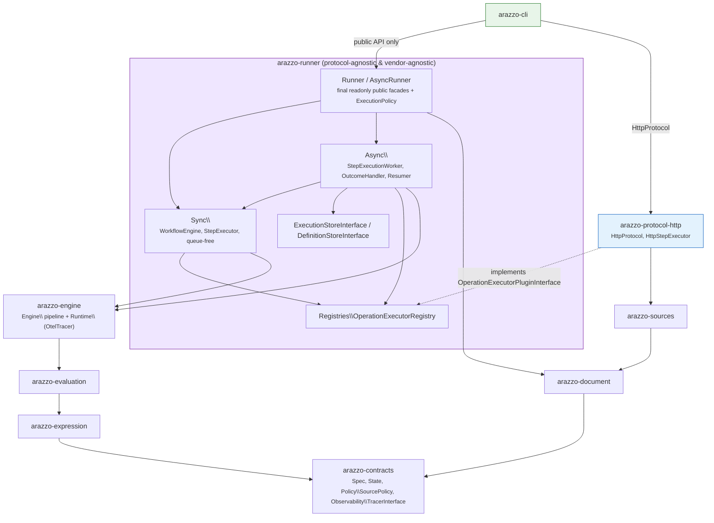

# 07 — Runner Package Map

## Purpose

Where execution lives and why: the package/layer model, the `Sync\`/`Async\` split inside `php-arazzo/arazzo-runner`, who owns which seam, and the arch tests that make each boundary un-crossable. See [ADR-009](../adr/ADR-009-runner-package-public-interface.md) for the runner public interface design, [ADR-010](../adr/ADR-010-monorepo-observability-and-policy-standards.md) for observability & `*Policy` standards, and [ADR-007](../adr/ADR-007-expression-package-public-interface-and-plugin-registries.md) / [ADR-008](../adr/ADR-008-plugin-attribute-naming-and-directory-convention.md) for plugin registries.

## The package model (source of truth)

| Layer | Package | Depends on |
|---|---|---|
| 0 | `php-arazzo/arazzo-contracts` | PHP + `psr/event-dispatcher` + `psr/clock` (Spec AST, `ExecutionState`, `WorkflowContext`, `Validation\*`, `Policy\{SourcePolicy, Credential}`, `Observability\{TracerInterface, SpanInterface, NullTracer}`, `Clock\SystemClock`, `Discovery\PluginDiscovery`, `Attributes\As*Plugin`, cross-package `Interfaces\*`) |
| 1 | `php-arazzo/arazzo-expression` | contracts (+ `softcreatr/jsonpath`) |
| 1 | `php-arazzo/arazzo-document` | contracts (+ `symfony/yaml`) |
| 1 | `php-arazzo/arazzo-evaluation` | contracts, expression |
| 2 | `php-arazzo/arazzo-engine` | contracts, evaluation, expression (`Alama\Arazzo\Engine\*` request pipeline helpers + `Alama\Arazzo\Runtime\*` state/policy/telemetry incl. `OtelTracer`) |
| 2 | `php-arazzo/arazzo-sources` | contracts, document, expression (spec normalizers & fetchers, zero `cebe`) |
| 3 | `php-arazzo/arazzo-runner` | contracts, document, expression, evaluation, engine — **protocol-agnostic, transport-free & vendor-agnostic** (zero `Protocol\*`, `Sources\*`, `GuzzleHttp`, `Psr\Http`, `cebe`, `OpenTelemetry`) |
| vertical | `php-arazzo/arazzo-protocol-http` | contracts, document, expression, evaluation, engine, sources (+ `cebe`/`guzzle`/PSR) — **never `runner` (DIP)**; public factory `HttpProtocol` |
| vertical | `php-arazzo/arazzo-protocol-soap` | contracts, document, expression, evaluation, engine, sources — **never `runner` (DIP)** |
| vertical | `php-arazzo/arazzo-protocol-rpc` | contracts, document, expression, evaluation, engine, sources — **never `runner` (DIP)** |
| host | `php-arazzo/arazzo-cli` | runner **public API only** (`Runner`, `AsyncRunner`, `ExecutionStoreInterface`, `DefinitionStoreInterface`, `Data\*`, `Policy\*`, `Store\*`, `Queue\SyncQueueDriver`, `Events\*`, `Exceptions\*`) |
| host | `alama/laravel-arazzo` (external repo) | runner **public API only** (`RunnerInterface`, `AsyncRunnerInterface`, `ExecutionStoreInterface`, `DefinitionStoreInterface`, `Policy\*`, `OperationExecutorRegistry`, `Events\*`, `Exceptions\*`) |

Dependency direction is strictly downward: `runner` never imports any `protocol-*` package; vertical protocol packages never import `runner` (DIP); hosts compose `runner` and `protocol-*` through their public facades and `OperationExecutorPluginInterface`.

## The `Sync\`/`Async\` split

| Side | Classes (`@internal`) | Enforced by |
|---|---|---|
| `Sync\` | `WorkflowEngine`, `WorkflowExecutor`, `StepExecutor`, `WorkflowDependencyResolver`, `ExecutionGraphFactory` | **queue-free** — must not reference `Async\` or `QueueDriverInterface` |
| `Async\` | `StepExecutionWorker`, `StepOutcomeHandler`, `CorrelationResumer`, `SubWorkflowInvoker`, `AsyncExecutionGraphAssembler` | **may compose `Sync\`** — the worker drives the same `WorkflowEngine` |
| public surface | `Runner`, `RunnerInterface`, `AsyncRunner`, `AsyncRunnerInterface`, `ExecutionStoreInterface`, `DefinitionStoreInterface`, `Data\{ExecutionResult, StepResult, ExecuteStepJob}`, `Policy\{ExecutionPolicy, ExecutionBudgets}`, `Store\{InMemoryExecutionStore, InMemoryDefinitionStore}`, `Queue\SyncQueueDriver`, `Registries\OperationExecutorRegistry`, `Events\*`, `Exceptions\*` | `packages/runner/tests/ArchTest.php` + `tests/Architecture/InternalApiTest.php` |

Rationale: sync execution is a plain transition loop (deterministic, synchronous, testable without queues); async execution is the queue-driven loop that re-enters the same `WorkflowEngine` between jobs. Expressing async *in terms of* sync and declaring sync queue-free keeps one transition semantics instead of two parallel implementations.

## Who owns which seam

| Seam (port) | protocol-http | runner | cli / framework hosts |
|---|---|---|---|
| `OperationExecutorPluginInterface` | `HttpProtocol::executor()` (`HttpStepExecutor`) | consumed via `OperationExecutorRegistry` + `withExecutor()`; ships `SubWorkflowStepExecutor` | registers via `withExecutor()` or `OperationExecutorRegistry::create()` |
| `OperationResolverInterface` | `HttpProtocol::resolver()` (`OpenApiOperationResolver`) | consumed by internal `Preflight` via `withOperationResolver()` | registers via `withOperationResolver()` |
| `OutputExtractorInterface` | `HttpProtocol::outputExtractor()` (`StepOutputExtractor`) | defaults to internal `EvaluationOutputExtractor`; optional override on `AsyncRunner::withOutputExtractor()` | binds optional override if schema casting on webhook resume is needed |
| `ExecutionStoreInterface` & `DefinitionStoreInterface` | — | owned by `runner` with public `Store\InMemoryExecutionStore` and `Store\InMemoryDefinitionStore` defaults | hosts bind durable DB/Redis/file stores via `withStore()` / `withDefinitions()` |
| `QueueDriverInterface` & `LockManagerInterface` | — | `AsyncRunner::create()` defaults to public `Queue\SyncQueueDriver` and internal `InMemoryLockManager` | hosts bind durable queue/lock drivers via `withQueueDriver()` / `withLockManager()` |
| `TracerInterface`, `LoggerInterface`, `EventDispatcherInterface`, `ClockInterface` | — | wired identically on `Runner` and `AsyncRunner` with zero-overhead defaults (`NullTracer`, `NullLogger`, `NullEventDispatcher`, `SystemClock`) | hosts bind `OtelTracer`, PSR-3 logger, PSR-14 listeners (e.g. `ExecutionHistory` / metrics), and PSR-20 clock |

Framework hosts discover DI-bound `#[AsOperationExecutorPlugin]` classes via `PluginDiscovery::classesWith(AsOperationExecutorPlugin::class)` (ADR-007/ADR-008) rather than hardcoded registrars.

## Arch rules that enforce the boundaries

| Rule | Guard | Location |
|---|---|---|
| Public facades & DTOs are `final readonly` | `Runner`, `AsyncRunner`, `ExecutionResult`, `StepResult`, `ExecuteStepJob`, `ExecutionPolicy`, `ExecutionBudgets` `toBeFinal()->toBeReadonly()` | `packages/runner/tests/ArchTest.php` |
| Runner is protocol-agnostic, transport-free & vendor-agnostic | `expect('Alama\Arazzo\Runner')->not->toUse(['Illuminate', 'cebe\openapi', 'GuzzleHttp', 'Psr\Http', 'OpenTelemetry', 'Alama\Arazzo\Protocol', 'Alama\Arazzo\Sources', 'Alama\Arazzo\Cli'])` | `packages/runner/tests/ArchTest.php` |
| Sync is queue-free | `expect('…Runner\Sync')->not->toUse(['…Runner\Async', 'QueueDriverInterface'])` | `packages/runner/tests/ArchTest.php` |
| Async may compose Sync | `expect('…Runner\Async')->toUse('…Runner\Sync')` | `packages/runner/tests/ArchTest.php` |
| Nothing below facades depends on facades | `Sync`/`Async` `not->toUse([Runner::class, AsyncRunner::class])` | `packages/runner/tests/ArchTest.php` |
| protocol-* must not depend on runner (**DIP**) | `expect('Alama\Arazzo\Protocol\*')->not->toUse('Alama\Arazzo\Runner')` | `packages/protocol-*/tests/Architecture/ArchTest.php` |
| Hosts import only public runner allow-list | allow-list check over `packages/cli/src` + 7-symbol ban in `packages/cli/tests/ArchTest.php` | `tests/Architecture/InternalApiTest.php`, `packages/cli/tests/ArchTest.php` |
| Events stay framework-agnostic & readonly | `Alama\Arazzo\Runner\Events\*` `toBeFinal()->toBeReadonly()` & `not->toUse` internals | `packages/runner/tests/Events/ArchTest.php` |

## Why there is no layer-2 request-pipeline package

The seven transport-agnostic request-pipeline helpers (`RequestCompiler`, `ParameterSerializer`, `TypeCaster`, `SchemaValidator`, `IdempotencyKeyInjector`, `StepParameterMerger`, `ReusableParameterResolver`, plus `Data\InjectionResult`) live in `php-arazzo/arazzo-engine` (`Alama\Arazzo\Engine\Execution\*`), not in a separate package and not in `runner`. Both `runner` and `protocol-*` packages legally depend on `engine`, preserving the DIP boundary without introducing a redundant intermediate package.

## Evidence

- [ADR-009: Runner Package Public Interface and Protocol-Agnostic Execution](../adr/ADR-009-runner-package-public-interface.md)
- [ADR-010: Monorepo Observability Tiers and `*Policy` Value-Object Standards](../adr/ADR-010-monorepo-observability-and-policy-standards.md)
- [`docs/research/2026-09-26-runner-package-split-validation.md`](../research/2026-09-26-runner-package-split-validation.md)
- [`docs/research/2026-09-08-arazzo-protocol-spec-prs-impact.md`](../research/2026-09-08-arazzo-protocol-spec-prs-impact.md)
