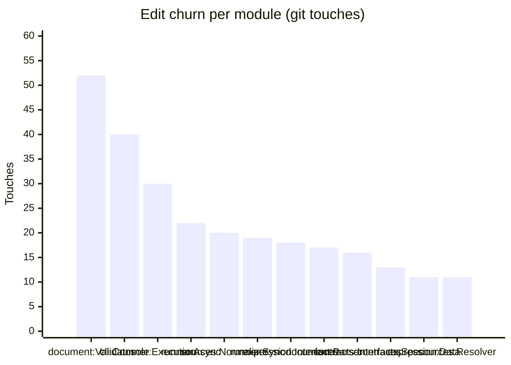

<!-- GENERATED by scripts/generate-docs.php — DO NOT EDIT.
     Refreshed automatically on every commit (see .githooks/pre-commit). -->

# Generated: Churn Hotspots

Where edit pressure lands. **Touches** = number of times a module's src files
appear in `git log` commits (full history, deterministic per HEAD). The
hotspot score normalizes churn by size: high touches-per-KLOC means a module
is edited far more often than its mass justifies — the classic "working in the
same corner every week" signal that static structure graphs cannot show.

Analyzed 480 total file-touches across 77 modules.

| Module | Touches | Share | LOC | Touches/KLOC |
|---|---:|---:|---:|---:|
| `document:Validator` | 52 | 11% | 662 | 78.5 |
| `cli:Console` | 40 | 8% | 803 | 49.8 |
| `runner:Execution` | 30 | 6% | 679 | 44.2 |
| `runner:Async` | 22 | 5% | 1,435 | 15.3 |
| `sources:Normalizer` | 20 | 4% | 503 | 39.8 |
| `runner:Sync` | 19 | 4% | 975 | 19.5 |
| `expression:Interfaces` | 18 | 4% | 214 | 84.1 |
| `document:Parser` | 17 | 4% | 2,434 | 7 |
| `contracts:Interfaces` | 16 | 3% | 387 | 41.3 |
| `contracts:Spec` | 13 | 3% | 1,300 | 10 |
| `expression:Data` | 11 | 2% | 199 | 55.3 |
| `sources:Resolver` | 11 | 2% | 629 | 17.5 |
| `evaluation:Plugins` | 10 | 2% | 125 | 80 |
| `evaluation:Registries` | 9 | 2% | 190 | 47.4 |
| `protocol-soap:Execution` | 9 | 2% | 484 | 18.6 |
| `engine:Execution` | 8 | 2% | 1,201 | 6.7 |
| `contracts:State` | 7 | 1% | 1,062 | 6.6 |
| `evaluation:Condition` | 7 | 1% | 1,054 | 6.6 |
| `expression:Plugins` | 7 | 1% | 1,371 | 5.1 |
| `protocol-http:Execution` | 6 | 1% | 927 | 6.5 |
| `protocol-rpc:Execution` | 6 | 1% | 188 | 31.9 |
| `runner:Events` | 6 | 1% | 187 | 32.1 |
| `contracts:Attributes` | 5 | 1% | 106 | 47.2 |
| `contracts:Dependency` | 5 | 1% | 375 | 13.3 |
| `engine:Runtime` | 5 | 1% | 1,844 | 2.7 |
| `expression:Ast` | 5 | 1% | 355 | 14.1 |
| `expression:Internal` | 5 | 1% | 921 | 5.4 |
| `expression:Registries` | 5 | 1% | 113 | 44.2 |
| `expression:Xpath` | 5 | 1% | 173 | 28.9 |
| `protocol-rpc:Normalizer` | 5 | 1% | 538 | 9.3 |
| `runner:Policy` | 5 | 1% | 124 | 40.3 |
| `runner:Preflight` | 5 | 1% | 156 | 32.1 |
| `cli:Generator` | 4 | 1% | 141 | 28.4 |
| `cli:Renderer` | 4 | 1% | 255 | 15.7 |
| `evaluation:Data` | 4 | 1% | 86 | 46.5 |
| `expression:Enum` | 4 | 1% | 47 | 85.1 |
| `contracts:Support` | 3 | 1% | 185 | 16.2 |
| `document:Registries` | 3 | 1% | 97 | 30.9 |
| `evaluation:Interfaces` | 3 | 1% | 44 | 68.2 |
| `expression:Exceptions` | 3 | 1% | 64 | 46.9 |
| `expression:JsonPath` | 3 | 1% | 1,470 | 2 |
| `protocol-http:Plugins` | 3 | 1% | 340 | 8.8 |
| `protocol-rpc:Protocol` | 3 | 1% | 514 | 5.8 |
| `runner:Exceptions` | 3 | 1% | 134 | 22.4 |
| `sources:Registries` | 3 | 1% | 81 | 37 |
| `contracts:Discovery` | 2 | 0% | 421 | 4.8 |
| `contracts:Exceptions` | 2 | 0% | 31 | 64.5 |
| `contracts:Validation` | 2 | 0% | 348 | 5.7 |
| `engine:Data` | 2 | 0% | 74 | 27 |
| `engine:Enum` | 2 | 0% | 17 | 117.6 |
| `evaluation:Enum` | 2 | 0% | 123 | 16.3 |
| `expression:Support` | 2 | 0% | 192 | 10.4 |
| `protocol-rpc:Plugins` | 2 | 0% | 422 | 4.7 |
| `protocol-soap:Plugins` | 2 | 0% | 859 | 2.3 |
| `protocol-soap:Validation` | 2 | 0% | 139 | 14.4 |
| `runner:Plugins` | 2 | 0% | 86 | 23.3 |
| `contracts:Clock` | 1 | 0% | 20 | 50 |
| `contracts:Data` | 1 | 0% | 155 | 6.5 |
| `contracts:Observability` | 1 | 0% | 108 | 9.3 |
| `contracts:Policy` | 1 | 0% | 268 | 3.7 |
| `document:Plugins` | 1 | 0% | 3,118 | 0.3 |
| `engine:Exceptions` | 1 | 0% | 42 | 23.8 |
| `evaluation:Events` | 1 | 0% | 27 | 37 |
| `expression:Policy` | 1 | 0% | 37 | 27 |
| `protocol-http:Policy` | 1 | 0% | 43 | 23.3 |
| `protocol-http:Resolver` | 1 | 0% | 285 | 3.5 |
| `protocol-rpc:Transfer` | 1 | 0% | 219 | 4.6 |
| `protocol-soap:Exceptions` | 1 | 0% | 16 | 62.5 |
| `protocol-soap:Resolver` | 1 | 0% | 136 | 7.4 |
| `protocol-soap:Transfer` | 1 | 0% | 203 | 4.9 |
| `runner:Data` | 1 | 0% | 123 | 8.1 |
| `runner:Queue` | 1 | 0% | 25 | 40 |
| `runner:Registries` | 1 | 0% | 151 | 6.6 |
| `runner:Store` | 1 | 0% | 138 | 7.2 |
| `sources:Exceptions` | 1 | 0% | 65 | 15.4 |
| `sources:Plugins` | 1 | 0% | 147 | 6.8 |
| `sources:Policy` | 1 | 0% | 125 | 8 |

**Hotspots** (highest touches-per-KLOC with meaningful size/churn): `expression:Interfaces` (84.1), `evaluation:Plugins` (80), `document:Validator` (78.5)
