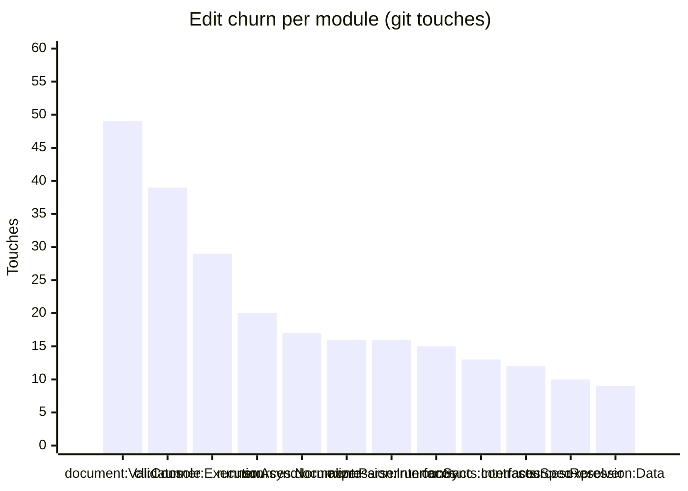

<!-- GENERATED by scripts/generate-docs.php — DO NOT EDIT.
     Refreshed automatically on every commit (see .githooks/pre-commit). -->

# Generated: Churn Hotspots

Where edit pressure lands. **Touches** = number of times a module's src files
appear in `git log` commits (full history, deterministic per HEAD). The
hotspot score normalizes churn by size: high touches-per-KLOC means a module
is edited far more often than its mass justifies — the classic "working in the
same corner every week" signal that static structure graphs cannot show.

Analyzed 397 total file-touches across 65 modules.

| Module | Touches | Share | LOC | Touches/KLOC |
|---|---:|---:|---:|---:|
| `document:Validator` | 49 | 12% | 3,779 | 13 |
| `cli:Console` | 39 | 10% | 939 | 41.5 |
| `runner:Execution` | 29 | 7% | 384 | 75.5 |
| `runner:Async` | 20 | 5% | 1,351 | 14.8 |
| `sources:Normalizer` | 17 | 4% | 592 | 28.7 |
| `document:Parser` | 16 | 4% | 2,241 | 7.1 |
| `expression:Interfaces` | 16 | 4% | 208 | 76.9 |
| `runner:Sync` | 15 | 4% | 1,082 | 13.9 |
| `contracts:Interfaces` | 13 | 3% | 412 | 31.6 |
| `contracts:Spec` | 12 | 3% | 1,279 | 9.4 |
| `sources:Resolver` | 10 | 3% | 478 | 20.9 |
| `expression:Data` | 9 | 2% | 198 | 45.5 |
| `protocol-http:Protocol` | 9 | 2% | 333 | 27 |
| `engine:Execution` | 8 | 2% | 1,031 | 7.8 |
| `evaluation:Plugins` | 8 | 2% | 124 | 64.5 |
| `evaluation:Registries` | 7 | 2% | 219 | 32 |
| `protocol-soap:Execution` | 7 | 2% | 599 | 11.7 |
| `evaluation:Condition` | 6 | 2% | 1,023 | 5.9 |
| `contracts:State` | 5 | 1% | 977 | 5.1 |
| `expression:Ast` | 5 | 1% | 355 | 14.1 |
| `expression:Xpath` | 5 | 1% | 173 | 28.9 |
| `protocol-http:Execution` | 5 | 1% | 536 | 9.3 |
| `protocol-rpc:Execution` | 5 | 1% | 315 | 15.9 |
| `runner:Events` | 5 | 1% | 328 | 15.2 |
| `cli:Generator` | 4 | 1% | 141 | 28.4 |
| `cli:Renderer` | 4 | 1% | 255 | 15.7 |
| `contracts:Dependency` | 4 | 1% | 336 | 11.9 |
| `evaluation:Data` | 4 | 1% | 86 | 46.5 |
| `expression:Enum` | 4 | 1% | 47 | 85.1 |
| `expression:Plugins` | 4 | 1% | 134 | 29.9 |
| `protocol-rpc:Normalizer` | 4 | 1% | 663 | 6 |
| `contracts:Support` | 3 | 1% | 185 | 16.2 |
| `engine:Runtime` | 3 | 1% | 1,639 | 1.8 |
| `evaluation:Interfaces` | 3 | 1% | 44 | 68.2 |
| `expression:Exceptions` | 3 | 1% | 64 | 46.9 |
| `expression:Internal` | 3 | 1% | 433 | 6.9 |
| `expression:Registries` | 3 | 1% | 130 | 23.1 |
| `runner:Preflight` | 3 | 1% | 150 | 20 |
| `contracts:Attributes` | 2 | 1% | 105 | 19 |
| `contracts:Exceptions` | 2 | 1% | 31 | 64.5 |
| `engine:Data` | 2 | 1% | 74 | 27 |
| `engine:Enum` | 2 | 1% | 17 | 117.6 |
| `evaluation:Enum` | 2 | 1% | 123 | 16.3 |
| `expression:JsonPath` | 2 | 1% | 1,378 | 1.5 |
| `protocol-rpc:Protocol` | 2 | 1% | 514 | 3.9 |
| `contracts:Data` | 1 | 0% | 155 | 6.5 |
| `engine:Exceptions` | 1 | 0% | 42 | 23.8 |
| `evaluation:Events` | 1 | 0% | 27 | 37 |
| `expression:Support` | 1 | 0% | 59 | 16.9 |
| `protocol-http:Resolver` | 1 | 0% | 285 | 3.5 |
| `protocol-rpc:Transfer` | 1 | 0% | 219 | 4.6 |
| `protocol-soap:Exceptions` | 1 | 0% | 16 | 62.5 |
| `protocol-soap:Normalizer` | 1 | 0% | 446 | 2.2 |
| `protocol-soap:Resolver` | 1 | 0% | 136 | 7.4 |
| `protocol-soap:Transfer` | 1 | 0% | 203 | 4.9 |
| `protocol-soap:Validation` | 1 | 0% | 353 | 2.8 |
| `runner:Exceptions` | 1 | 0% | 20 | 50 |
| `runner:Interfaces` | 1 | 0% | 25 | 40 |
| `sources:Exceptions` | 1 | 0% | 65 | 15.4 |
| `contracts:Discovery` | 0 | 0% | 294 | 0 |
| `contracts:Validation` | 0 | 0% | 331 | 0 |
| `document:Registries` | 0 | 0% | 94 | 0 |
| `expression:Validation` | 0 | 0% | 1,412 | 0 |
| `protocol-rpc:Validation` | 0 | 0% | 79 | 0 |
| `sources:Registries` | 0 | 0% | 98 | 0 |

**Hotspots** (highest touches-per-KLOC with meaningful size/churn): `expression:Interfaces` (76.9), `runner:Execution` (75.5), `evaluation:Plugins` (64.5)
