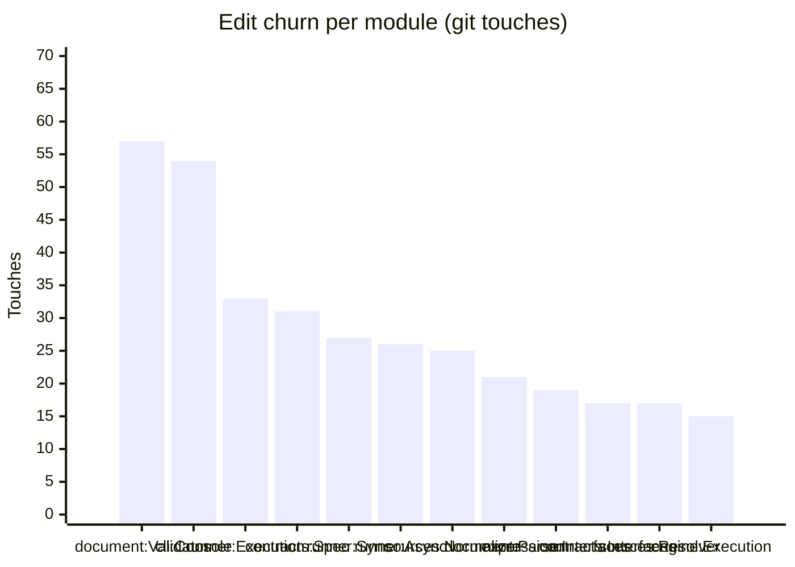

<!-- GENERATED by scripts/generate-docs.php — DO NOT EDIT.
     Refreshed automatically on every commit (see .githooks/pre-commit). -->

# Generated: Churn Hotspots

Where edit pressure lands. **Touches** = number of times a module's src files
appear in `git log` commits (full history, deterministic per HEAD). The
hotspot score normalizes churn by size: high touches-per-KLOC means a module
is edited far more often than its mass justifies — the classic "working in the
same corner every week" signal that static structure graphs cannot show.

Analyzed 677 total file-touches across 83 modules.

| Module | Touches | Share | LOC | Touches/KLOC |
|---|---:|---:|---:|---:|
| `document:Validator` | 57 | 8% | 790 | 72.2 |
| `cli:Console` | 54 | 8% | 1,379 | 39.2 |
| `runner:Execution` | 33 | 5% | 723 | 45.6 |
| `contracts:Spec` | 31 | 5% | 2,996 | 10.3 |
| `runner:Sync` | 27 | 4% | 1,507 | 17.9 |
| `runner:Async` | 26 | 4% | 1,457 | 17.8 |
| `sources:Normalizer` | 25 | 4% | 950 | 26.3 |
| `document:Parser` | 21 | 3% | 2,482 | 8.5 |
| `expression:Interfaces` | 19 | 3% | 252 | 75.4 |
| `contracts:Interfaces` | 17 | 3% | 416 | 40.9 |
| `sources:Resolver` | 17 | 3% | 899 | 18.9 |
| `engine:Execution` | 15 | 2% | 1,358 | 11 |
| `expression:Data` | 15 | 2% | 390 | 38.5 |
| `expression:Plugins` | 13 | 2% | 1,486 | 8.7 |
| `protocol-http:Plugins` | 12 | 2% | 391 | 30.7 |
| `protocol-http:Execution` | 11 | 2% | 2,265 | 4.9 |
| `cli:Renderer` | 10 | 1% | 317 | 31.5 |
| `evaluation:Plugins` | 10 | 1% | 125 | 80 |
| `evaluation:Registries` | 10 | 1% | 190 | 52.6 |
| `protocol-soap:Execution` | 10 | 1% | 444 | 22.5 |
| `document:Plugins` | 9 | 1% | 3,454 | 2.6 |
| `evaluation:Condition` | 9 | 1% | 1,149 | 7.8 |
| `contracts:State` | 8 | 1% | 1,242 | 6.4 |
| `expression:Internal` | 8 | 1% | 885 | 9 |
| `contracts:Validation` | 7 | 1% | 504 | 13.9 |
| `engine:Runtime` | 7 | 1% | 1,870 | 3.7 |
| `protocol-http:Resolver` | 7 | 1% | 616 | 11.4 |
| `protocol-rpc:Execution` | 7 | 1% | 176 | 39.8 |
| `protocol-rpc:Normalizer` | 7 | 1% | 604 | 11.6 |
| `runner:Preflight` | 7 | 1% | 304 | 23 |
| `contracts:Dependency` | 6 | 1% | 490 | 12.2 |
| `contracts:Exceptions` | 6 | 1% | 378 | 15.9 |
| `expression:Registries` | 6 | 1% | 113 | 53.1 |
| `protocol-soap:Plugins` | 6 | 1% | 864 | 6.9 |
| `runner:Events` | 6 | 1% | 187 | 32.1 |
| `runner:Policy` | 6 | 1% | 177 | 33.9 |
| `sources:Plugins` | 6 | 1% | 377 | 15.9 |
| `cli:Generator` | 5 | 1% | 141 | 35.5 |
| `contracts:Attributes` | 5 | 1% | 106 | 47.2 |
| `evaluation:Data` | 5 | 1% | 96 | 52.1 |
| `expression:Ast` | 5 | 1% | 355 | 14.1 |
| `expression:Enum` | 5 | 1% | 79 | 63.3 |
| `expression:Xpath` | 5 | 1% | 173 | 28.9 |
| `runner:Exceptions` | 5 | 1% | 377 | 13.3 |
| `sources:Exceptions` | 5 | 1% | 287 | 17.4 |
| `expression:Exceptions` | 4 | 1% | 209 | 19.1 |
| `expression:JsonPath` | 4 | 1% | 1,470 | 2.7 |
| `expression:Support` | 4 | 1% | 339 | 11.8 |
| `protocol-rpc:Plugins` | 4 | 1% | 393 | 10.2 |
| `protocol-rpc:Protocol` | 4 | 1% | 501 | 8 |
| `runner:Data` | 4 | 1% | 280 | 14.3 |
| `runner:Plugins` | 4 | 1% | 89 | 44.9 |
| `contracts:Discovery` | 3 | 0% | 416 | 7.2 |
| `contracts:Support` | 3 | 0% | 185 | 16.2 |
| `document:Registries` | 3 | 0% | 97 | 30.9 |
| `engine:Data` | 3 | 0% | 99 | 30.3 |
| `evaluation:Interfaces` | 3 | 0% | 44 | 68.2 |
| `protocol-http:Exceptions` | 3 | 0% | 313 | 9.6 |
| `protocol-http:Policy` | 3 | 0% | 679 | 4.4 |
| `protocol-soap:Validation` | 3 | 0% | 139 | 21.6 |
| `sources:Registries` | 3 | 0% | 81 | 37 |
| `contracts:Data` | 2 | 0% | 361 | 5.5 |
| `engine:Enum` | 2 | 0% | 17 | 117.6 |
| `engine:Exceptions` | 2 | 0% | 222 | 9 |
| `evaluation:Enum` | 2 | 0% | 123 | 16.3 |
| `evaluation:Exceptions` | 2 | 0% | 42 | 47.6 |
| `protocol-rpc:Transfer` | 2 | 0% | 243 | 8.2 |
| `protocol-soap:Exceptions` | 2 | 0% | 152 | 13.2 |
| `protocol-soap:Transfer` | 2 | 0% | 227 | 8.8 |
| `sources:Policy` | 2 | 0% | 125 | 16 |
| `cli:Exceptions` | 1 | 0% | 51 | 19.6 |
| `contracts:Clock` | 1 | 0% | 20 | 50 |
| `contracts:Observability` | 1 | 0% | 108 | 9.3 |
| `contracts:Policy` | 1 | 0% | 268 | 3.7 |
| `evaluation:Events` | 1 | 0% | 27 | 37 |
| `expression:Policy` | 1 | 0% | 37 | 27 |
| `protocol-http:Enum` | 1 | 0% | 12 | 83.3 |
| `protocol-rpc:Exceptions` | 1 | 0% | 187 | 5.3 |
| `protocol-soap:Resolver` | 1 | 0% | 136 | 7.4 |
| `runner:Queue` | 1 | 0% | 25 | 40 |
| `runner:Registries` | 1 | 0% | 151 | 6.6 |
| `runner:Store` | 1 | 0% | 138 | 7.2 |
| `sources:Inspection` | 1 | 0% | 103 | 9.7 |

**Hotspots** (highest touches-per-KLOC with meaningful size/churn): `evaluation:Plugins` (80), `expression:Interfaces` (75.4), `document:Validator` (72.2)
