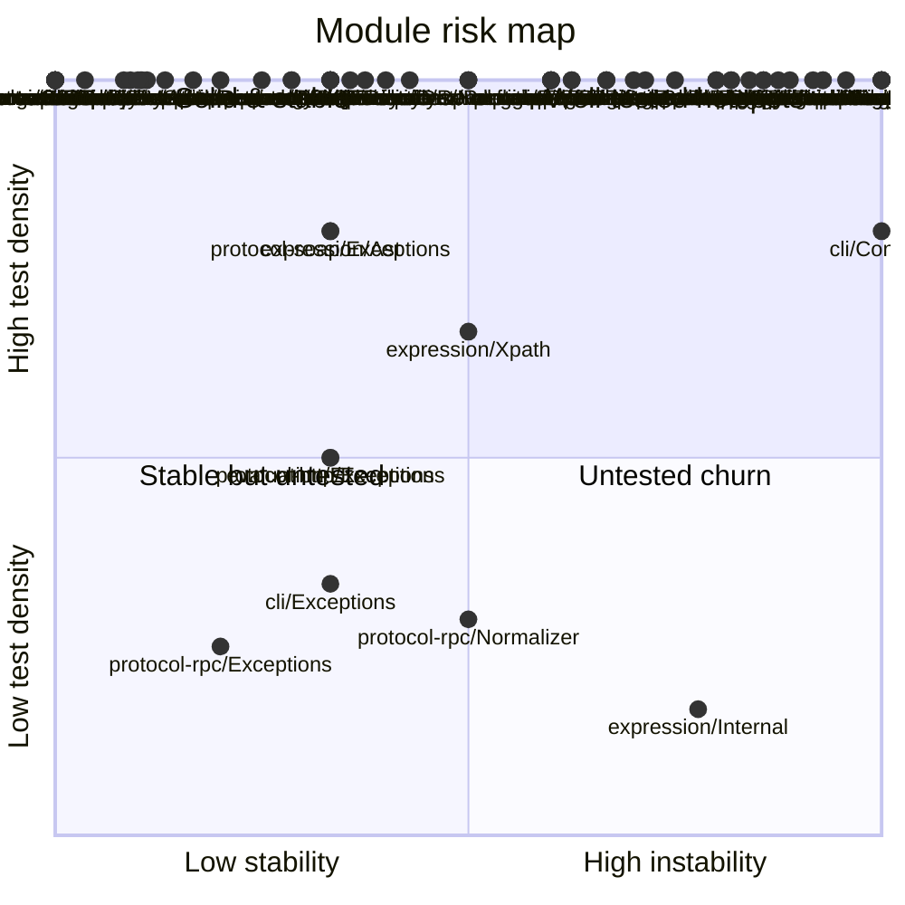

<!-- GENERATED by scripts/generate-docs.php — DO NOT EDIT.
     Refreshed automatically on every commit (see .githooks/pre-commit). -->

# Generated: Coverage / Risk Quadrant

Each module plotted by **instability** (x, from the coupling graph) vs **test
density** (y: test files referencing the module ÷ src files in it).

- *Untested churn* (bottom-right) — changing constantly with no safety net: refactor first.
- *Well-tested hotspots* (top-right) — churn is paid for; keep tests green.
- Test density is file-level and name-based (a test file counts once per
  module whose class names it mentions); it is a proxy, not line coverage.

| Module | Instability | Test files | Src files | Density |
|---|---:|---:|---:|---:|
| `cli/Console` | 1.00 | 8 | 10 | 80% |
| `cli/Exceptions` | 0.33 | 1 | 3 | 33% |
| `cli/Generator` | 1.00 | 2 | 2 | 100% |
| `cli/Renderer` | 0.50 | 6 | 3 | 100% |
| `contracts/Attributes` | 0.13 | 10 | 6 | 100% |
| `contracts/Clock` | 0.00 | 2 | 1 | 100% |
| `contracts/Data` | 0.17 | 5 | 2 | 100% |
| `contracts/Dependency` | 0.33 | 6 | 3 | 100% |
| `contracts/Discovery` | 0.20 | 4 | 3 | 100% |
| `contracts/Exceptions` | 0.10 | 7 | 5 | 100% |
| `contracts/Interfaces` | 0.10 | 50 | 20 | 100% |
| `contracts/Observability` | 0.00 | 9 | 4 | 100% |
| `contracts/Policy` | 0.00 | 12 | 5 | 100% |
| `contracts/Spec` | 0.04 | 304 | 52 | 100% |
| `contracts/State` | 0.10 | 91 | 4 | 100% |
| `contracts/Support` | 0.00 | 13 | 5 | 100% |
| `contracts/Validation` | 0.11 | 97 | 9 | 100% |
| `document/Parser` | 0.29 | 65 | 31 | 100% |
| `document/Plugins` | 1.00 | 52 | 50 | 100% |
| `document/Registries` | 0.80 | 3 | 1 | 100% |
| `document/Validator` | 0.71 | 26 | 6 | 100% |
| `engine/Data` | 0.75 | 4 | 2 | 100% |
| `engine/Enum` | 0.00 | 1 | 1 | 100% |
| `engine/Exceptions` | 0.09 | 12 | 8 | 100% |
| `engine/Execution` | 0.36 | 15 | 10 | 100% |
| `engine/Runtime` | 0.60 | 26 | 21 | 100% |
| `evaluation/Condition` | 0.89 | 84 | 18 | 100% |
| `evaluation/Data` | 0.40 | 14 | 2 | 100% |
| `evaluation/Enum` | 0.00 | 8 | 5 | 100% |
| `evaluation/Events` | 0.33 | 1 | 1 | 100% |
| `evaluation/Exceptions` | 0.33 | 1 | 2 | 50% |
| `evaluation/Interfaces` | 0.60 | 2 | 2 | 100% |
| `evaluation/Plugins` | 1.00 | 4 | 2 | 100% |
| `evaluation/Registries` | 0.86 | 7 | 2 | 100% |
| `expression/Ast` | 0.33 | 12 | 15 | 80% |
| `expression/Data` | 0.25 | 29 | 6 | 100% |
| `expression/Enum` | 0.00 | 10 | 2 | 100% |
| `expression/Exceptions` | 0.08 | 19 | 4 | 100% |
| `expression/Interfaces` | 0.33 | 24 | 4 | 100% |
| `expression/Internal` | 0.78 | 1 | 6 | 17% |
| `expression/JsonPath` | 0.67 | 65 | 9 | 100% |
| `expression/Plugins` | 1.00 | 23 | 17 | 100% |
| `expression/Policy` | 0.00 | 3 | 1 | 100% |
| `expression/Registries` | 0.62 | 5 | 1 | 100% |
| `expression/Support` | 0.67 | 5 | 2 | 100% |
| `expression/Xpath` | 0.50 | 2 | 3 | 67% |
| `protocol-http/Exceptions` | 0.33 | 1 | 2 | 50% |
| `protocol-http/Execution` | 0.86 | 26 | 6 | 100% |
| `protocol-http/Plugins` | 0.92 | 18 | 2 | 100% |
| `protocol-http/Policy` | 0.33 | 2 | 1 | 100% |
| `protocol-http/Resolver` | 0.70 | 19 | 3 | 100% |
| `protocol-rpc/Exceptions` | 0.20 | 1 | 4 | 25% |
| `protocol-rpc/Execution` | 0.88 | 3 | 2 | 100% |
| `protocol-rpc/Normalizer` | 0.50 | 2 | 7 | 29% |
| `protocol-rpc/Plugins` | 0.93 | 6 | 3 | 100% |
| `protocol-rpc/Protocol` | 0.62 | 6 | 4 | 100% |
| `protocol-rpc/Transfer` | 0.60 | 4 | 2 | 100% |
| `protocol-soap/Exceptions` | 0.33 | 4 | 5 | 80% |
| `protocol-soap/Execution` | 0.82 | 6 | 4 | 100% |
| `protocol-soap/Plugins` | 0.93 | 7 | 5 | 100% |
| `protocol-soap/Resolver` | 1.00 | 1 | 1 | 100% |
| `protocol-soap/Transfer` | 0.33 | 6 | 2 | 100% |
| `protocol-soap/Validation` | 1.00 | 1 | 1 | 100% |
| `runner/Async` | 0.96 | 17 | 6 | 100% |
| `runner/Data` | 0.43 | 18 | 3 | 100% |
| `runner/Events` | 0.00 | 18 | 9 | 100% |
| `runner/Exceptions` | 0.38 | 13 | 11 | 100% |
| `runner/Execution` | 0.86 | 26 | 12 | 100% |
| `runner/Plugins` | 0.82 | 6 | 1 | 100% |
| `runner/Policy` | 0.29 | 4 | 2 | 100% |
| `runner/Preflight` | 0.50 | 6 | 2 | 100% |
| `runner/Queue` | 0.33 | 13 | 1 | 100% |
| `runner/Registries` | 0.60 | 23 | 1 | 100% |
| `runner/Store` | 0.60 | 18 | 2 | 100% |
| `runner/Sync` | 0.84 | 38 | 7 | 100% |
| `sources/Exceptions` | 0.00 | 10 | 8 | 100% |
| `sources/Normalizer` | 0.50 | 7 | 6 | 100% |
| `sources/Plugins` | 1.00 | 3 | 1 | 100% |
| `sources/Policy` | 0.33 | 3 | 1 | 100% |
| `sources/Registries` | 0.80 | 5 | 1 | 100% |
| `sources/Resolver` | 0.67 | 26 | 12 | 100% |

**Refactor-now list** (untested churn): `expression/Internal`, `protocol-rpc/Normalizer`
