<!-- GENERATED by scripts/generate-docs.php — DO NOT EDIT.
     Refreshed automatically on every commit (see .githooks/pre-commit). -->

# Generated: Document Model (`Spec\`)

The immutable Arazzo document value-object tree, scanned live from
`packages/core/src/Spec`. Composition edges are derived from constructor
promoted properties whose types resolve to other `Spec\` classes.

```mermaid
classDiagram
    direction LR
    class Action <<value>>
    class ActionCollection
    class ActionKind
    class ArazzoDocument
    class Components
    class CriterionCollection
    class CriterionType
    class ExecutionStatus
    class Expression
    class ExpressionType
    class FailureAction <<value>>
    class FailureEndAction <<value>>
    class FailureGotoAction <<value>>
    class Format
    class GraphQlOperation
    class Info
    class Interaction
    class InteractionMode
    class NormalizedOpenApiOperation
    class OpenApiPayload
    class OperationProtocol
    class OutputMap
    class Parameter
    class ParameterCollection
    class ParameterIn
    class PayloadReplacement
    class PendingCorrelation
    class RawDocument
    class RequestBody
    class ResolvedOperation
    class ResponseTransfer
    class RetryAction <<value>>
    class Reusable
    class RpcProtocol
    class Selector
    class SourceDescription
    class SourceDescriptionCollection
    class SourceDocument
    class SourceIdentity
    class SourceType
    class SpecVersion
    class Step
    class StepCollection
    class StepExecutionOutcome
    class StepFactory
    class StepFlow
    class StepIo
    class StepState
    class StepStatus
    class StepTarget
    class StringList
    class SubWorkflowFailureAction <<value>>
    class SubWorkflowSuccessAction <<value>>
    class SuccessAction <<value>>
    class SuccessCriterion
    class SuccessEndAction <<value>>
    class SuccessGotoAction <<value>>
    class ValueMode
    class Workflow
    class WorkflowCollection
    ActionCollection "1" --> "0..1" SuccessAction : holds
    ActionCollection "1" --> "0..1" FailureAction : holds
    ActionCollection "1" --> "0..1" Reusable : holds
    Action "1" --> "0..1" ActionKind : holds
    FailureAction "1" --> "0..*" SuccessCriterion : holds
    FailureEndAction "1" --> "0..*" SuccessCriterion : holds
    FailureGotoAction "1" --> "0..*" SuccessCriterion : holds
    FailureGotoAction "1" --> "0..1" Parameter : holds
    FailureGotoAction "1" --> "0..1" Reusable : holds
    RetryAction "1" --> "0..*" SuccessCriterion : holds
    SubWorkflowFailureAction "1" --> "0..1" Expression : holds
    SubWorkflowFailureAction "1" --> "0..1" Selector : holds
    SubWorkflowFailureAction "1" --> "0..*" SuccessCriterion : holds
    SubWorkflowSuccessAction "1" --> "0..1" Expression : holds
    SubWorkflowSuccessAction "1" --> "0..1" Selector : holds
    SubWorkflowSuccessAction "1" --> "0..*" SuccessCriterion : holds
    SuccessAction "1" --> "0..*" SuccessCriterion : holds
    SuccessEndAction "1" --> "0..*" SuccessCriterion : holds
    SuccessGotoAction "1" --> "0..*" SuccessCriterion : holds
    SuccessGotoAction "1" --> "0..1" Parameter : holds
    SuccessGotoAction "1" --> "0..1" Reusable : holds
    ArazzoDocument "1" --> "0..1" Info : holds
    ArazzoDocument "1" --> "0..1" Components : holds
    ArazzoDocument "1" --> "0..1" SpecVersion : holds
    ArazzoDocument "1" --> "0..*" SourceDescription : holds
    ArazzoDocument "1" --> "0..1" SourceDescriptionCollection : holds
    ArazzoDocument "1" --> "0..*" Workflow : holds
    ArazzoDocument "1" --> "0..1" WorkflowCollection : holds
    Components "1" --> "0..1" Parameter : holds
    Components "1" --> "0..1" SuccessAction : holds
    Components "1" --> "0..1" FailureAction : holds
    Components "1" --> "0..1" Interaction : holds
    CriterionCollection "1" --> "0..*" SuccessCriterion : holds
    GraphQlOperation "1" --> "0..1" Selector : holds
    Interaction "1" --> "0..1" InteractionMode : holds
    OutputMap "1" --> "0..1" Expression : holds
    OutputMap "1" --> "0..1" Selector : holds
    Parameter "1" --> "0..1" ParameterIn : holds
    Parameter "1" --> "0..1" ValueMode : holds
    Parameter "1" --> "0..1" Expression : holds
    Parameter "1" --> "0..1" Selector : holds
    ParameterCollection "1" --> "0..1" Parameter : holds
    ParameterCollection "1" --> "0..1" Reusable : holds
    PayloadReplacement "1" --> "0..1" Expression : holds
    PayloadReplacement "1" --> "0..1" Selector : holds
    RawDocument "1" --> "0..1" Format : holds
    RequestBody "1" --> "0..1" PayloadReplacement : holds
    ResolvedOperation "1" --> "0..*" SourceDescription : holds
    ResolvedOperation "1" --> "0..1" NormalizedOpenApiOperation : holds
    ResolvedOperation "1" --> "0..1" RpcProtocol : holds
    ResolvedOperation "1" --> "0..1" GraphQlOperation : holds
    ResolvedOperation "1" --> "0..1" Interaction : holds
    Reusable "1" --> "0..1" Expression : holds
    Reusable "1" --> "0..1" Selector : holds
    Selector "1" --> "0..1" ExpressionType : holds
    SourceDescription "1" --> "0..1" SourceType : holds
    SourceDescriptionCollection "1" --> "0..*" SourceDescription : holds
    SourceDocument "1" --> "0..1" SourceType : holds
    SourceIdentity "1" --> "0..1" SourceDocument : holds
    Step "1" --> "0..1" StepTarget : holds
    Step "1" --> "0..1" StepFlow : holds
    Step "1" --> "0..1" StepIo : holds
    StepCollection "1" --> "0..*" Step : holds
    StepFlow "1" --> "0..1" StringList : holds
    StepFlow "1" --> "0..1" SuccessAction : holds
    StepFlow "1" --> "0..1" Reusable : holds
    StepFlow "1" --> "0..1" ActionCollection : holds
    StepFlow "1" --> "0..1" FailureAction : holds
    StepIo "1" --> "0..1" RequestBody : holds
    StepIo "1" --> "0..1" Parameter : holds
    StepIo "1" --> "0..1" Reusable : holds
    StepIo "1" --> "0..1" ParameterCollection : holds
    StepIo "1" --> "0..*" SuccessCriterion : holds
    StepIo "1" --> "0..1" CriterionCollection : holds
    StepIo "1" --> "0..1" Expression : holds
    StepIo "1" --> "0..1" Selector : holds
    StepIo "1" --> "0..1" OutputMap : holds
    StepTarget "1" --> "0..1" Expression : holds
    StepTarget "1" --> "0..1" RpcProtocol : holds
    StepTarget "1" --> "0..1" GraphQlOperation : holds
    StepTarget "1" --> "0..1" Interaction : holds
    SuccessCriterion "1" --> "0..1" CriterionType : holds
    Workflow "1" --> "0..1" StringList : holds
    Workflow "1" --> "0..*" Step : holds
    Workflow "1" --> "0..1" StepCollection : holds
    Workflow "1" --> "0..1" SuccessAction : holds
    Workflow "1" --> "0..1" Reusable : holds
    Workflow "1" --> "0..1" ActionCollection : holds
    Workflow "1" --> "0..1" FailureAction : holds
    Workflow "1" --> "0..1" Expression : holds
    Workflow "1" --> "0..1" Selector : holds
    Workflow "1" --> "0..1" OutputMap : holds
    Workflow "1" --> "0..1" Parameter : holds
    Workflow "1" --> "0..1" ParameterCollection : holds
    WorkflowCollection "1" --> "0..*" Workflow : holds
```

## Enumerations

- **ActionKind** — `goto` &middot; `end` &middot; `retry` &middot; `invoke`
- **CriterionType** — `simple` &middot; `regex` &middot; `jsonpath` &middot; `xpath`
- **ExecutionStatus** — `running` &middot; `succeeded` &middot; `failed`
- **ExpressionType** — `jsonpath` &middot; `xpath` &middot; `jsonpointer`
- **Format** — `yaml` &middot; `json`
- **InteractionMode** — `form` &middot; `redirect` &middot; `acknowledge`
- **OperationProtocol** — `sub-workflow` &middot; `soap` &middot; `rpc` &middot; `asyncapi` &middot; `http`
- **ParameterIn** — `path` &middot; `query` &middot; `header` &middot; `cookie` &middot; `body` &middot; `querystring` &middot; `metadata` &middot; `variable`
- **RpcProtocol** — `grpc` &middot; `grpc-web` &middot; `twirp` &middot; `connect`
- **SourceType** — `openapi` &middot; `arazzo` &middot; `asyncapi` &middot; `wsdl` &middot; `protobuf` &middot; `graphql`
- **SpecVersion** — `1.0.0` &middot; `1.1.0` &middot; `1.2.0`
- **StepState** — `pending` &middot; `executing_request` &middot; `evaluating_criteria` &middot; `awaiting_actor_input` &middot; `actor_input_received` &middot; `completed` &middot; `failed` &middot; `cancelled`
- **StepStatus** — `pending` &middot; `succeeded` &middot; `failed` &middot; `retrying` &middot; `suspended`
- **ValueMode** — `literal` &middot; `selector`
