<!-- GENERATED by scripts/generate-docs.php — DO NOT EDIT.
     Refreshed automatically on every commit (see .githooks/pre-commit). -->

# Generated: Exception Tree

Every exception class in both packages and what it extends, scanned live from
source. Use this to decide which exception to throw or catch.

```mermaid
classDiagram
    direction TB
    class E_RuntimeException["RuntimeException"]:::builtin
    class E_LogicException["LogicException"]:::builtin
    class E_InvalidArgumentException["InvalidArgumentException"]:::builtin
    class E_BaseException["BaseException"]:::builtin
    class E_ArazzoException["ArazzoException<br/><small>contracts:Support</small>"]:::domain
    class E_AsyncApiStepException["AsyncApiStepException<br/><small>protocol-http:Exceptions</small>"]:::domain
    class E_CliException["CliException<br/><small>cli:Exceptions</small>"]:::domain
    class E_CliExecutionException["CliExecutionException<br/><small>cli:Exceptions</small>"]:::domain
    class E_ConditionLexException["ConditionLexException<br/><small>evaluation:Condition</small>"]:::domain
    class E_ConditionSyntaxException["ConditionSyntaxException<br/><small>evaluation:Condition</small>"]:::domain
    class E_CriterionEvaluationException["CriterionEvaluationException<br/><small>evaluation:Exceptions</small>"]:::domain
    class E_CustomTagsForbiddenException["CustomTagsForbiddenException<br/><small>document:Parser</small>"]:::domain
    class E_DecodeException["DecodeException<br/><small>document:Parser</small>"]:::domain
    class E_DecodeLimitException["DecodeLimitException<br/><small>document:Parser</small>"]:::domain
    class E_DefinitionHydrationException["DefinitionHydrationException<br/><small>engine:Runtime</small>"]:::domain
    class E_EngineException["EngineException<br/><small>engine:Exceptions</small>"]:::domain
    class E_ExecutionException["ExecutionException<br/><small>engine:Exceptions</small>"]:::domain
    class E_ExpressionSyntaxException["ExpressionSyntaxException<br/><small>expression:Exceptions</small>"]:::domain
    class E_GeneratorApiException["GeneratorApiException<br/><small>cli:Exceptions</small>"]:::domain
    class E_GotoTargetNotFoundException["GotoTargetNotFoundException<br/><small>runner:Exceptions</small>"]:::domain
    class E_InvalidFetchPolicyException["InvalidFetchPolicyException<br/><small>sources:Exceptions</small>"]:::domain
    class E_InvalidOpenApiSourceException["InvalidOpenApiSourceException<br/><small>sources:Exceptions</small>"]:::domain
    class E_InvalidRetryPolicyException["InvalidRetryPolicyException<br/><small>engine:Exceptions</small>"]:::domain
    class E_InvalidSelectorPluginException["InvalidSelectorPluginException<br/><small>expression:Exceptions</small>"]:::domain
    class E_InvalidSourcePolicyException["InvalidSourcePolicyException<br/><small>runner:Exceptions</small>"]:::domain
    class E_InvalidSourceReferenceException["InvalidSourceReferenceException<br/><small>sources:Exceptions</small>"]:::domain
    class E_InvalidSpecVersionException["InvalidSpecVersionException<br/><small>contracts:Exceptions</small>"]:::domain
    class E_InvalidStepTargetException["InvalidStepTargetException<br/><small>contracts:Exceptions</small>"]:::domain
    class E_InvalidWsdlDocumentException["InvalidWsdlDocumentException<br/><small>protocol-soap:Exceptions</small>"]:::domain
    class E_JsonPathSyntaxException["JsonPathSyntaxException<br/><small>expression:Exceptions</small>"]:::domain
    class E_LoaderException["LoaderException<br/><small>document:Parser</small>"]:::domain
    class E_LockException["LockException<br/><small>engine:Exceptions</small>"]:::domain
    class E_MaxAliasesExceededException["MaxAliasesExceededException<br/><small>document:Parser</small>"]:::domain
    class E_MaxBytesExceededException["MaxBytesExceededException<br/><small>document:Parser</small>"]:::domain
    class E_MaxDepthExceededException["MaxDepthExceededException<br/><small>document:Parser</small>"]:::domain
    class E_MaxNodesExceededException["MaxNodesExceededException<br/><small>document:Parser</small>"]:::domain
    class E_NotImplementedException["NotImplementedException<br/><small>contracts:Support</small>"]:::domain
    class E_ObjectDeserializationForbiddenException["ObjectDeserializationForbiddenException<br/><small>document:Parser</small>"]:::domain
    class E_OpenApiResolutionException["OpenApiResolutionException<br/><small>protocol-http:Exceptions</small>"]:::domain
    class E_OperationResolutionException["OperationResolutionException<br/><small>runner:Exceptions</small>"]:::domain
    class E_ParameterResolutionException["ParameterResolutionException<br/><small>engine:Exceptions</small>"]:::domain
    class E_ParserException["ParserException<br/><small>document:Parser</small>"]:::domain
    class E_PluginInstantiationException["PluginInstantiationException<br/><small>contracts:Exceptions</small>"]:::domain
    class E_PreflightFailureException["PreflightFailureException<br/><small>runner:Exceptions</small>"]:::domain
    class E_ProtoSyntaxException["ProtoSyntaxException<br/><small>protocol-rpc:Exceptions</small>"]:::domain
    class E_ProtobufResolutionException["ProtobufResolutionException<br/><small>protocol-rpc:Exceptions</small>"]:::domain
    class E_RegistryInitializationException["RegistryInitializationException<br/><small>evaluation:Exceptions</small>"]:::domain
    class E_RpcCodecException["RpcCodecException<br/><small>protocol-rpc:Exceptions</small>"]:::domain
    class E_RpcExecutionException["RpcExecutionException<br/><small>protocol-rpc:Exceptions</small>"]:::domain
    class E_RunnerException["RunnerException<br/><small>runner:Exceptions</small>"]:::domain
    class E_SchemaValidationException["SchemaValidationException<br/><small>contracts:Exceptions</small>"]:::domain
    class E_SelectorEvaluationException["SelectorEvaluationException<br/><small>expression:Exceptions</small>"]:::domain
    class E_SoapEnvelopeException["SoapEnvelopeException<br/><small>protocol-soap:Exceptions</small>"]:::domain
    class E_SoapExecutionException["SoapExecutionException<br/><small>protocol-soap:Exceptions</small>"]:::domain
    class E_SourceFetchException["SourceFetchException<br/><small>sources:Resolver</small>"]:::domain
    class E_SourceParseException["SourceParseException<br/><small>sources:Resolver</small>"]:::domain
    class E_SourceResolutionException["SourceResolutionException<br/><small>sources:Resolver</small>"]:::domain
    class E_StateStoreException["StateStoreException<br/><small>engine:Exceptions</small>"]:::domain
    class E_StepBudgetExceededException["StepBudgetExceededException<br/><small>runner:Exceptions</small>"]:::domain
    class E_TelemetrySetupException["TelemetrySetupException<br/><small>engine:Exceptions</small>"]:::domain
    class E_TypeCastException["TypeCastException<br/><small>engine:Exceptions</small>"]:::domain
    class E_UnknownWorkflowException["UnknownWorkflowException<br/><small>runner:Exceptions</small>"]:::domain
    class E_UnresolvableReferenceException["UnresolvableReferenceException<br/><small>sources:Resolver</small>"]:::domain
    class E_UnresolvableReusableReferenceException["UnresolvableReusableReferenceException<br/><small>contracts:Exceptions</small>"]:::domain
    class E_UnsupportedSerializationStyleException["UnsupportedSerializationStyleException<br/><small>document:Parser</small>"]:::domain
    class E_UnsupportedSourceVersionException["UnsupportedSourceVersionException<br/><small>protocol-soap:Exceptions</small>"]:::domain
    class E_UnsupportedStepException["UnsupportedStepException<br/><small>runner:Exceptions</small>"]:::domain
    class E_WorkflowCycleException["WorkflowCycleException<br/><small>runner:Exceptions</small>"]:::domain
    class E_WorkflowDepthExceededException["WorkflowDepthExceededException<br/><small>runner:Exceptions</small>"]:::domain
    class E_WsdlResolutionException["WsdlResolutionException<br/><small>protocol-soap:Exceptions</small>"]:::domain
    E_RuntimeException <|-- E_ArazzoException
    E_LogicException <|-- E_AsyncApiStepException
    E_RuntimeException <|-- E_CliException
    E_CliException <|-- E_CliExecutionException
    E_ConditionSyntaxException <|-- E_ConditionLexException
    E_ArazzoException <|-- E_ConditionSyntaxException
    E_ArazzoException <|-- E_CriterionEvaluationException
    E_DecodeLimitException <|-- E_CustomTagsForbiddenException
    E_RuntimeException <|-- E_DecodeException
    E_DecodeException <|-- E_DecodeLimitException
    E_RuntimeException <|-- E_DefinitionHydrationException
    E_RuntimeException <|-- E_EngineException
    E_EngineException <|-- E_ExecutionException
    E_ArazzoException <|-- E_ExpressionSyntaxException
    E_CliException <|-- E_GeneratorApiException
    E_RunnerException <|-- E_GotoTargetNotFoundException
    E_InvalidArgumentException <|-- E_InvalidFetchPolicyException
    E_InvalidArgumentException <|-- E_InvalidOpenApiSourceException
    E_InvalidArgumentException <|-- E_InvalidRetryPolicyException
    E_InvalidArgumentException <|-- E_InvalidSelectorPluginException
    E_RunnerException <|-- E_InvalidSourcePolicyException
    E_SourceResolutionException <|-- E_InvalidSourceReferenceException
    E_InvalidArgumentException <|-- E_InvalidSpecVersionException
    E_InvalidArgumentException <|-- E_InvalidStepTargetException
    E_InvalidArgumentException <|-- E_InvalidWsdlDocumentException
    E_ArazzoException <|-- E_JsonPathSyntaxException
    E_ArazzoException <|-- E_LoaderException
    E_EngineException <|-- E_LockException
    E_DecodeLimitException <|-- E_MaxAliasesExceededException
    E_DecodeLimitException <|-- E_MaxBytesExceededException
    E_DecodeLimitException <|-- E_MaxDepthExceededException
    E_DecodeLimitException <|-- E_MaxNodesExceededException
    E_ArazzoException <|-- E_NotImplementedException
    E_DecodeLimitException <|-- E_ObjectDeserializationForbiddenException
    E_EngineException <|-- E_OpenApiResolutionException
    E_RunnerException <|-- E_OperationResolutionException
    E_EngineException <|-- E_ParameterResolutionException
    E_ArazzoException <|-- E_ParserException
    E_ArazzoException <|-- E_PluginInstantiationException
    E_RunnerException <|-- E_PreflightFailureException
    E_InvalidArgumentException <|-- E_ProtoSyntaxException
    E_EngineException <|-- E_ProtobufResolutionException
    E_InvalidArgumentException <|-- E_RegistryInitializationException
    E_EngineException <|-- E_RpcCodecException
    E_ExecutionException <|-- E_RpcExecutionException
    E_RuntimeException <|-- E_RunnerException
    E_RuntimeException <|-- E_SchemaValidationException
    E_ArazzoException <|-- E_SelectorEvaluationException
    E_EngineException <|-- E_SoapEnvelopeException
    E_ExecutionException <|-- E_SoapExecutionException
    E_BaseException <|-- E_SourceFetchException
    E_BaseException <|-- E_SourceParseException
    E_RuntimeException <|-- E_SourceResolutionException
    E_EngineException <|-- E_StateStoreException
    E_RunnerException <|-- E_StepBudgetExceededException
    E_EngineException <|-- E_TelemetrySetupException
    E_InvalidArgumentException <|-- E_TypeCastException
    E_RunnerException <|-- E_UnknownWorkflowException
    E_BaseException <|-- E_UnresolvableReferenceException
    E_ArazzoException <|-- E_UnresolvableReusableReferenceException
    E_RuntimeException <|-- E_UnsupportedSerializationStyleException
    E_RuntimeException <|-- E_UnsupportedSourceVersionException
    E_LogicException <|-- E_UnsupportedStepException
    E_RunnerException <|-- E_WorkflowCycleException
    E_RunnerException <|-- E_WorkflowDepthExceededException
    E_EngineException <|-- E_WsdlResolutionException
    classDef builtin fill:#f1f5f9,stroke:#64748b,color:#1a1a1a;
    classDef domain fill:#fce8e6,stroke:#ea4335,color:#1a1a1a;
```

| Exception | Extends | Module |
|---|---|---|
| `ArazzoException` | `RuntimeException` | contracts:Support |
| `AsyncApiStepException` | `LogicException` | protocol-http:Exceptions |
| `CliException` | `RuntimeException` | cli:Exceptions |
| `CliExecutionException` | `CliException` | cli:Exceptions |
| `ConditionLexException` | `ConditionSyntaxException` | evaluation:Condition |
| `ConditionSyntaxException` | `ArazzoException` | evaluation:Condition |
| `CriterionEvaluationException` | `ArazzoException` | evaluation:Exceptions |
| `CustomTagsForbiddenException` | `DecodeLimitException` | document:Parser |
| `DecodeException` | `RuntimeException` | document:Parser |
| `DecodeLimitException` | `DecodeException` | document:Parser |
| `DefinitionHydrationException` | `RuntimeException` | engine:Runtime |
| `EngineException` | `RuntimeException` | engine:Exceptions |
| `ExecutionException` | `EngineException` | engine:Exceptions |
| `ExpressionSyntaxException` | `ArazzoException` | expression:Exceptions |
| `GeneratorApiException` | `CliException` | cli:Exceptions |
| `GotoTargetNotFoundException` | `RunnerException` | runner:Exceptions |
| `InvalidFetchPolicyException` | `InvalidArgumentException` | sources:Exceptions |
| `InvalidOpenApiSourceException` | `InvalidArgumentException` | sources:Exceptions |
| `InvalidRetryPolicyException` | `InvalidArgumentException` | engine:Exceptions |
| `InvalidSelectorPluginException` | `InvalidArgumentException` | expression:Exceptions |
| `InvalidSourcePolicyException` | `RunnerException` | runner:Exceptions |
| `InvalidSourceReferenceException` | `SourceResolutionException` | sources:Exceptions |
| `InvalidSpecVersionException` | `InvalidArgumentException` | contracts:Exceptions |
| `InvalidStepTargetException` | `InvalidArgumentException` | contracts:Exceptions |
| `InvalidWsdlDocumentException` | `InvalidArgumentException` | protocol-soap:Exceptions |
| `JsonPathSyntaxException` | `ArazzoException` | expression:Exceptions |
| `LoaderException` | `ArazzoException` | document:Parser |
| `LockException` | `EngineException` | engine:Exceptions |
| `MaxAliasesExceededException` | `DecodeLimitException` | document:Parser |
| `MaxBytesExceededException` | `DecodeLimitException` | document:Parser |
| `MaxDepthExceededException` | `DecodeLimitException` | document:Parser |
| `MaxNodesExceededException` | `DecodeLimitException` | document:Parser |
| `NotImplementedException` | `ArazzoException` | contracts:Support |
| `ObjectDeserializationForbiddenException` | `DecodeLimitException` | document:Parser |
| `OpenApiResolutionException` | `EngineException` | protocol-http:Exceptions |
| `OperationResolutionException` | `RunnerException` | runner:Exceptions |
| `ParameterResolutionException` | `EngineException` | engine:Exceptions |
| `ParserException` | `ArazzoException` | document:Parser |
| `PluginInstantiationException` | `ArazzoException` | contracts:Exceptions |
| `PreflightFailureException` | `RunnerException` | runner:Exceptions |
| `ProtoSyntaxException` | `InvalidArgumentException` | protocol-rpc:Exceptions |
| `ProtobufResolutionException` | `EngineException` | protocol-rpc:Exceptions |
| `RegistryInitializationException` | `InvalidArgumentException` | evaluation:Exceptions |
| `RpcCodecException` | `EngineException` | protocol-rpc:Exceptions |
| `RpcExecutionException` | `ExecutionException` | protocol-rpc:Exceptions |
| `RunnerException` | `RuntimeException` | runner:Exceptions |
| `SchemaValidationException` | `RuntimeException` | contracts:Exceptions |
| `SelectorEvaluationException` | `ArazzoException` | expression:Exceptions |
| `SoapEnvelopeException` | `EngineException` | protocol-soap:Exceptions |
| `SoapExecutionException` | `ExecutionException` | protocol-soap:Exceptions |
| `SourceFetchException` | `BaseException` | sources:Resolver |
| `SourceParseException` | `BaseException` | sources:Resolver |
| `SourceResolutionException` | `RuntimeException` | sources:Resolver |
| `StateStoreException` | `EngineException` | engine:Exceptions |
| `StepBudgetExceededException` | `RunnerException` | runner:Exceptions |
| `TelemetrySetupException` | `EngineException` | engine:Exceptions |
| `TypeCastException` | `InvalidArgumentException` | engine:Exceptions |
| `UnknownWorkflowException` | `RunnerException` | runner:Exceptions |
| `UnresolvableReferenceException` | `BaseException` | sources:Resolver |
| `UnresolvableReusableReferenceException` | `ArazzoException` | contracts:Exceptions |
| `UnsupportedSerializationStyleException` | `RuntimeException` | document:Parser |
| `UnsupportedSourceVersionException` | `RuntimeException` | protocol-soap:Exceptions |
| `UnsupportedStepException` | `LogicException` | runner:Exceptions |
| `WorkflowCycleException` | `RunnerException` | runner:Exceptions |
| `WorkflowDepthExceededException` | `RunnerException` | runner:Exceptions |
| `WsdlResolutionException` | `EngineException` | protocol-soap:Exceptions |
