<!-- GENERATED by scripts/generate-docs.php — DO NOT EDIT.
     Refreshed automatically on every commit (see .githooks/pre-commit). -->

# Generated: Exception Tree

Every exception class in both packages and what it extends, scanned live from
source. Use this to decide which exception to throw or catch.

```mermaid
classDiagram
    direction TB
    class E_RuntimeException["RuntimeException"]:::builtin
    class E_BaseException["BaseException"]:::builtin
    class E_ArazzoException["ArazzoException<br/><small>contracts:Support</small>"]:::domain
    class E_ConditionSyntaxException["ConditionSyntaxException<br/><small>evaluation:Condition</small>"]:::domain
    class E_CustomTagsForbiddenException["CustomTagsForbiddenException<br/><small>document:Parser</small>"]:::domain
    class E_DecodeException["DecodeException<br/><small>document:Parser</small>"]:::domain
    class E_DecodeLimitException["DecodeLimitException<br/><small>document:Parser</small>"]:::domain
    class E_DefinitionHydrationException["DefinitionHydrationException<br/><small>engine:Runtime</small>"]:::domain
    class E_ExecutionException["ExecutionException<br/><small>engine:Exceptions</small>"]:::domain
    class E_ExpressionSyntaxException["ExpressionSyntaxException<br/><small>expression:Exceptions</small>"]:::domain
    class E_GotoTargetNotFoundException["GotoTargetNotFoundException<br/><small>runner:Exceptions</small>"]:::domain
    class E_InvalidSourcePolicyException["InvalidSourcePolicyException<br/><small>runner:Exceptions</small>"]:::domain
    class E_LoaderException["LoaderException<br/><small>document:Parser</small>"]:::domain
    class E_MaxAliasesExceededException["MaxAliasesExceededException<br/><small>document:Parser</small>"]:::domain
    class E_MaxBytesExceededException["MaxBytesExceededException<br/><small>document:Parser</small>"]:::domain
    class E_MaxDepthExceededException["MaxDepthExceededException<br/><small>document:Parser</small>"]:::domain
    class E_MaxNodesExceededException["MaxNodesExceededException<br/><small>document:Parser</small>"]:::domain
    class E_NotImplementedException["NotImplementedException<br/><small>contracts:Support</small>"]:::domain
    class E_ObjectDeserializationForbiddenException["ObjectDeserializationForbiddenException<br/><small>document:Parser</small>"]:::domain
    class E_ParserException["ParserException<br/><small>document:Parser</small>"]:::domain
    class E_PreflightFailureException["PreflightFailureException<br/><small>runner:Exceptions</small>"]:::domain
    class E_RunnerException["RunnerException<br/><small>runner:Exceptions</small>"]:::domain
    class E_SchemaValidationException["SchemaValidationException<br/><small>contracts:Exceptions</small>"]:::domain
    class E_SelectorEvaluationException["SelectorEvaluationException<br/><small>expression:Exceptions</small>"]:::domain
    class E_SourceFetchException["SourceFetchException<br/><small>sources:Resolver</small>"]:::domain
    class E_SourceParseException["SourceParseException<br/><small>sources:Resolver</small>"]:::domain
    class E_SourceResolutionException["SourceResolutionException<br/><small>sources:Resolver</small>"]:::domain
    class E_StepBudgetExceededException["StepBudgetExceededException<br/><small>runner:Exceptions</small>"]:::domain
    class E_UnknownWorkflowException["UnknownWorkflowException<br/><small>runner:Exceptions</small>"]:::domain
    class E_UnresolvableReferenceException["UnresolvableReferenceException<br/><small>sources:Resolver</small>"]:::domain
    class E_UnsupportedSerializationStyleException["UnsupportedSerializationStyleException<br/><small>document:Parser</small>"]:::domain
    class E_UnsupportedSourceVersionException["UnsupportedSourceVersionException<br/><small>protocol-soap:Exceptions</small>"]:::domain
    class E_WorkflowCycleException["WorkflowCycleException<br/><small>runner:Exceptions</small>"]:::domain
    class E_WorkflowDepthExceededException["WorkflowDepthExceededException<br/><small>runner:Exceptions</small>"]:::domain
    E_RuntimeException <|-- E_ArazzoException
    E_ArazzoException <|-- E_ConditionSyntaxException
    E_DecodeLimitException <|-- E_CustomTagsForbiddenException
    E_RuntimeException <|-- E_DecodeException
    E_DecodeException <|-- E_DecodeLimitException
    E_RuntimeException <|-- E_DefinitionHydrationException
    E_ArazzoException <|-- E_ExecutionException
    E_ArazzoException <|-- E_ExpressionSyntaxException
    E_RunnerException <|-- E_GotoTargetNotFoundException
    E_RunnerException <|-- E_InvalidSourcePolicyException
    E_ArazzoException <|-- E_LoaderException
    E_DecodeLimitException <|-- E_MaxAliasesExceededException
    E_DecodeLimitException <|-- E_MaxBytesExceededException
    E_DecodeLimitException <|-- E_MaxDepthExceededException
    E_DecodeLimitException <|-- E_MaxNodesExceededException
    E_ArazzoException <|-- E_NotImplementedException
    E_DecodeLimitException <|-- E_ObjectDeserializationForbiddenException
    E_ArazzoException <|-- E_ParserException
    E_RunnerException <|-- E_PreflightFailureException
    E_RuntimeException <|-- E_RunnerException
    E_RuntimeException <|-- E_SchemaValidationException
    E_ArazzoException <|-- E_SelectorEvaluationException
    E_BaseException <|-- E_SourceFetchException
    E_BaseException <|-- E_SourceParseException
    E_RuntimeException <|-- E_SourceResolutionException
    E_RunnerException <|-- E_StepBudgetExceededException
    E_RunnerException <|-- E_UnknownWorkflowException
    E_BaseException <|-- E_UnresolvableReferenceException
    E_RuntimeException <|-- E_UnsupportedSerializationStyleException
    E_RuntimeException <|-- E_UnsupportedSourceVersionException
    E_RunnerException <|-- E_WorkflowCycleException
    E_RunnerException <|-- E_WorkflowDepthExceededException
    classDef builtin fill:#f1f5f9,stroke:#64748b,color:#1a1a1a;
    classDef domain fill:#fce8e6,stroke:#ea4335,color:#1a1a1a;
```

| Exception | Extends | Module |
|---|---|---|
| `ArazzoException` | `RuntimeException` | contracts:Support |
| `ConditionSyntaxException` | `ArazzoException` | evaluation:Condition |
| `CustomTagsForbiddenException` | `DecodeLimitException` | document:Parser |
| `DecodeException` | `RuntimeException` | document:Parser |
| `DecodeLimitException` | `DecodeException` | document:Parser |
| `DefinitionHydrationException` | `RuntimeException` | engine:Runtime |
| `ExecutionException` | `ArazzoException` | engine:Exceptions |
| `ExpressionSyntaxException` | `ArazzoException` | expression:Exceptions |
| `GotoTargetNotFoundException` | `RunnerException` | runner:Exceptions |
| `InvalidSourcePolicyException` | `RunnerException` | runner:Exceptions |
| `LoaderException` | `ArazzoException` | document:Parser |
| `MaxAliasesExceededException` | `DecodeLimitException` | document:Parser |
| `MaxBytesExceededException` | `DecodeLimitException` | document:Parser |
| `MaxDepthExceededException` | `DecodeLimitException` | document:Parser |
| `MaxNodesExceededException` | `DecodeLimitException` | document:Parser |
| `NotImplementedException` | `ArazzoException` | contracts:Support |
| `ObjectDeserializationForbiddenException` | `DecodeLimitException` | document:Parser |
| `ParserException` | `ArazzoException` | document:Parser |
| `PreflightFailureException` | `RunnerException` | runner:Exceptions |
| `RunnerException` | `RuntimeException` | runner:Exceptions |
| `SchemaValidationException` | `RuntimeException` | contracts:Exceptions |
| `SelectorEvaluationException` | `ArazzoException` | expression:Exceptions |
| `SourceFetchException` | `BaseException` | sources:Resolver |
| `SourceParseException` | `BaseException` | sources:Resolver |
| `SourceResolutionException` | `RuntimeException` | sources:Resolver |
| `StepBudgetExceededException` | `RunnerException` | runner:Exceptions |
| `UnknownWorkflowException` | `RunnerException` | runner:Exceptions |
| `UnresolvableReferenceException` | `BaseException` | sources:Resolver |
| `UnsupportedSerializationStyleException` | `RuntimeException` | document:Parser |
| `UnsupportedSourceVersionException` | `RuntimeException` | protocol-soap:Exceptions |
| `WorkflowCycleException` | `RunnerException` | runner:Exceptions |
| `WorkflowDepthExceededException` | `RunnerException` | runner:Exceptions |
