<!-- GENERATED by scripts/generate-docs.php — DO NOT EDIT.
     Refreshed automatically on every commit (see .githooks/pre-commit). -->

# Generated: Extension Points (SPI)

Every contract interface that other code implements, with its live
implementation set — the package's openness map. Contracts under a `Contracts`
directory are deliberate SPI; others appear when the codebase itself treats an
interface polymorphically. Interfaces nobody implements are listed separately:
either dead seams or seams waiting for their first adapter.

```mermaid
mindmap
  root((SPI contracts))
    AiClientInterface
      OpenAiClient
    AsyncRunnerInterface
      AsyncRunner
    BackoffCalculatorInterface
      ExponentialBackoffCalculator
    CriteriaEvaluatorInterface
      CriteriaEvaluator
    CriterionEvaluatorPluginInterface
      JsonPathCriterionPlugin
    DecoderInterface
      NativeJsonDecoder
      SymfonyYamlDecoder
    DefinitionStoreInterface
      InMemoryDefinitionStore
    DocumentInterface
      Document
    EvaluationEngineInterface
      EvaluationEngine
    EvaluationInputInterface
      EvaluationContext
    ExecutionStoreInterface
      InMemoryExecutionStore
      CliExecutionStore
    ExpressionEngineInterface
      ExpressionEngine
    ExpressionEvaluatorPluginInterface
      JsonPathExpressionPlugin
    LockManagerInterface
      InMemoryLockManager
    LockStrategyInterface
      FileLockStrategy
      NullLockStrategy
      PessimisticLockStrategy
    OpenApiExecutorInterface
      DefaultOpenApiExecutor
    OpenApiNormalizerInterface
      OpenApi30Normalizer
    OperationExecutorPluginInterface
      AsyncApiStepExecutor
      HttpStepExecutor
      RpcOperationExecutor
      SoapOperationExecutor
      SubWorkflowStepExecutor
    OperationResolverInterface
      OpenApiOperationResolver
      ProtobufOperationResolver
      WsdlOperationResolver
    OutputExtractorInterface
      StepOutputExtractor
      EvaluationOutputExtractor
    ParserInterface
      Parser
      CachedParser
      Parser
    PendingCorrelationRegistryInterface
      ExecutionStoreCorrelationBridge
    QueueDriverInterface
      SyncQueueDriver
    ReplacementTargetResolverInterface
      XPathReplacementTargetResolver
    ResponseTransferInterface
      ResponseTransfer
      RpcResponseTransfer
      SoapResponseTransfer
    ResponseValidatorInterface
      ResponseSchemaValidator
      XsdResponseValidator
    RunnerInterface
      Runner
    SelectorPluginInterface
      JsonPathSelectorPlugin
      JsonPointerSelectorPlugin
      XpathSelectorPlugin
    SourceNormalizerInterface
      OpenApiSourceNormalizer
      ProtoSourceNormalizer
      WsdlSourceNormalizer
    SourcesInterface
      Sources
    SpanInterface
      NullSpan
      OtelSpan
    StateStoreInterface
      FileStateStore
      InMemoryStateStore
    StepProtocolExecutorInterface
      AsyncApiStepExecutor
      HttpStepExecutor
    TracerInterface
      NullTracer
      OtelTracer
    ValidationRuleInterface
      ActionOutputTargetExclusivityRule
      ExpressionContextMisuseRule
      ExpressionJsonPointerSyntaxRule
      ExpressionSyntaxRule
      ExpressionUnresolvedComponentRefRule
      ExpressionUnresolvedInputRefRule
      ExpressionUnresolvedSourceRefRule
      ExpressionUnresolvedStepRefRule
      ExpressionUnresolvedWorkflowRefRule
      JsonPathCriterionConditionRule
      MessageRefRequiresReceiveRule
      SelectorTypeSupportedRule
      StepOperationPathSyntaxRule
      ActionDuplicateRule
      ActionGotoTargetResolvesRule
      ActionParameterInForbiddenRule
      ActionRetryLimitsRule
      ActionReusableRefResolvesRule
      ActionTargetExclusivityRule
      ActionTypeValidRule
      AsyncApiFieldsRequire11Rule
      ComponentsUniqueNamesRule
      DocUnknownFieldRule
      DocumentArazzoVersionRule
      DocumentInfoRequiredRule
      DocumentSourceDescriptionsPresentRule
      ExtensionsXPrefixRule
      GraphQlStepRule
      InteractionStepRule
      OfficialSchemaRule
      ParameterQuerystringOperationShapeRule
      ParameterReusableRefResolvesRule
      ReceiveStepSuccessCriteriaRule
      SelfUriSyntaxRule
      SourceTypeMatchesRule
      SourceUniqueNameRule
      SourceUrlSyntaxRule
      StepAtLeastOneRule
      StepCriteriaTypeContextRule
      StepDependsOnNoCycleRule
      StepIdPatternRule
      StepNestedWorkflowExistsRule
      StepNestedWorkflowNoCycleRule
      StepOperationIdResolvesRule
      StepOperationIdSourceScopedRule
      StepOperationTargetPresentRule
      StepOutputsUniqueRule
      StepParameterDuplicateRule
      StepParameterInValidRule
      StepParameterRequiresInRule
      StepParametersHaveNameRule
      StepRequestBodyReplacementsTargetRule
      StepRequestBodyWorkflowRule
      StepSuccessCriteriaConditionRule
      StepTimeoutRequires11Rule
      StepUniqueIdRule
      SubWorkflowInvokeTargetResolvesRule
      WorkflowAtLeastOneRule
      WorkflowDependsOnExistsRule
      WorkflowDependsOnNoCycleRule
      WorkflowIdPatternRule
      WorkflowInputsValidSchemaRule
      WorkflowUniqueIdRule
      StepSuccessActionParameterInRule
      RpcStepRule
      WsdlStepRule
    WorkflowContextInterface
      WorkflowContext
    WorkflowStateRepositoryInterface
      StoredWorkflowStateRepository
```

| Contract | SPI dir | Implementations |
|---|---|---|
| `AiClientInterface` | no | `OpenAiClient` <small>core</small> |
| `AsyncRunnerInterface` | no | `AsyncRunner` <small>core</small> |
| `BackoffCalculatorInterface` | no | `ExponentialBackoffCalculator` <small>core</small> |
| `CriteriaEvaluatorInterface` | no | `CriteriaEvaluator` <small>core</small> |
| `CriterionEvaluatorPluginInterface` | no | `JsonPathCriterionPlugin` <small>core</small> |
| `DecoderInterface` | no | `NativeJsonDecoder` <small>core</small>, `SymfonyYamlDecoder` <small>core</small> |
| `DefinitionStoreInterface` | no | `InMemoryDefinitionStore` <small>core</small> |
| `DocumentInterface` | no | `Document` <small>core</small> |
| `EvaluationEngineInterface` | no | `EvaluationEngine` <small>core</small> |
| `EvaluationInputInterface` | no | `EvaluationContext` <small>core</small> |
| `ExecutionStoreInterface` | no | `InMemoryExecutionStore` <small>core</small>, `CliExecutionStore` <small>core</small> |
| `ExpressionEngineInterface` | no | `ExpressionEngine` <small>core</small> |
| `ExpressionEvaluatorPluginInterface` | no | `JsonPathExpressionPlugin` <small>core</small> |
| `LockManagerInterface` | no | `InMemoryLockManager` <small>core</small> |
| `LockStrategyInterface` | no | `FileLockStrategy` <small>core</small>, `NullLockStrategy` <small>core</small>, `PessimisticLockStrategy` <small>core</small> |
| `OpenApiExecutorInterface` | no | `DefaultOpenApiExecutor` <small>core</small> |
| `OpenApiNormalizerInterface` | no | `OpenApi30Normalizer` <small>core</small> |
| `OperationExecutorPluginInterface` | no | `AsyncApiStepExecutor` <small>core</small>, `HttpStepExecutor` <small>core</small>, `RpcOperationExecutor` <small>core</small>, `SoapOperationExecutor` <small>core</small>, `SubWorkflowStepExecutor` <small>core</small> |
| `OperationResolverInterface` | no | `OpenApiOperationResolver` <small>core</small>, `ProtobufOperationResolver` <small>core</small>, `WsdlOperationResolver` <small>core</small> |
| `OutputExtractorInterface` | no | `StepOutputExtractor` <small>core</small>, `EvaluationOutputExtractor` <small>core</small> |
| `ParserInterface` | no | `Parser` <small>core</small>, `CachedParser` <small>core</small>, `Parser` <small>core</small> |
| `PendingCorrelationRegistryInterface` | no | `ExecutionStoreCorrelationBridge` <small>core</small> |
| `QueueDriverInterface` | no | `SyncQueueDriver` <small>core</small> |
| `ReplacementTargetResolverInterface` | no | `XPathReplacementTargetResolver` <small>core</small> |
| `ResponseTransferInterface` | no | `ResponseTransfer` <small>core</small>, `RpcResponseTransfer` <small>core</small>, `SoapResponseTransfer` <small>core</small> |
| `ResponseValidatorInterface` | no | `ResponseSchemaValidator` <small>core</small>, `XsdResponseValidator` <small>core</small> |
| `RunnerInterface` | no | `Runner` <small>core</small> |
| `SelectorPluginInterface` | no | `JsonPathSelectorPlugin` <small>core</small>, `JsonPointerSelectorPlugin` <small>core</small>, `XpathSelectorPlugin` <small>core</small> |
| `SourceNormalizerInterface` | no | `OpenApiSourceNormalizer` <small>core</small>, `ProtoSourceNormalizer` <small>core</small>, `WsdlSourceNormalizer` <small>core</small> |
| `SourcesInterface` | no | `Sources` <small>core</small> |
| `SpanInterface` | no | `NullSpan` <small>core</small>, `OtelSpan` <small>core</small> |
| `StateStoreInterface` | no | `FileStateStore` <small>core</small>, `InMemoryStateStore` <small>core</small> |
| `StepProtocolExecutorInterface` | no | `AsyncApiStepExecutor` <small>core</small>, `HttpStepExecutor` <small>core</small> |
| `TracerInterface` | no | `NullTracer` <small>core</small>, `OtelTracer` <small>core</small> |
| `ValidationRuleInterface` | no | `ActionOutputTargetExclusivityRule` <small>core</small>, `ExpressionContextMisuseRule` <small>core</small>, `ExpressionJsonPointerSyntaxRule` <small>core</small>, `ExpressionSyntaxRule` <small>core</small>, `ExpressionUnresolvedComponentRefRule` <small>core</small>, `ExpressionUnresolvedInputRefRule` <small>core</small>, `ExpressionUnresolvedSourceRefRule` <small>core</small>, `ExpressionUnresolvedStepRefRule` <small>core</small>, `ExpressionUnresolvedWorkflowRefRule` <small>core</small>, `JsonPathCriterionConditionRule` <small>core</small>, `MessageRefRequiresReceiveRule` <small>core</small>, `SelectorTypeSupportedRule` <small>core</small>, `StepOperationPathSyntaxRule` <small>core</small>, `ActionDuplicateRule` <small>core</small>, `ActionGotoTargetResolvesRule` <small>core</small>, `ActionParameterInForbiddenRule` <small>core</small>, `ActionRetryLimitsRule` <small>core</small>, `ActionReusableRefResolvesRule` <small>core</small>, `ActionTargetExclusivityRule` <small>core</small>, `ActionTypeValidRule` <small>core</small>, `AsyncApiFieldsRequire11Rule` <small>core</small>, `ComponentsUniqueNamesRule` <small>core</small>, `DocUnknownFieldRule` <small>core</small>, `DocumentArazzoVersionRule` <small>core</small>, `DocumentInfoRequiredRule` <small>core</small>, `DocumentSourceDescriptionsPresentRule` <small>core</small>, `ExtensionsXPrefixRule` <small>core</small>, `GraphQlStepRule` <small>core</small>, `InteractionStepRule` <small>core</small>, `OfficialSchemaRule` <small>core</small>, `ParameterQuerystringOperationShapeRule` <small>core</small>, `ParameterReusableRefResolvesRule` <small>core</small>, `ReceiveStepSuccessCriteriaRule` <small>core</small>, `SelfUriSyntaxRule` <small>core</small>, `SourceTypeMatchesRule` <small>core</small>, `SourceUniqueNameRule` <small>core</small>, `SourceUrlSyntaxRule` <small>core</small>, `StepAtLeastOneRule` <small>core</small>, `StepCriteriaTypeContextRule` <small>core</small>, `StepDependsOnNoCycleRule` <small>core</small>, `StepIdPatternRule` <small>core</small>, `StepNestedWorkflowExistsRule` <small>core</small>, `StepNestedWorkflowNoCycleRule` <small>core</small>, `StepOperationIdResolvesRule` <small>core</small>, `StepOperationIdSourceScopedRule` <small>core</small>, `StepOperationTargetPresentRule` <small>core</small>, `StepOutputsUniqueRule` <small>core</small>, `StepParameterDuplicateRule` <small>core</small>, `StepParameterInValidRule` <small>core</small>, `StepParameterRequiresInRule` <small>core</small>, `StepParametersHaveNameRule` <small>core</small>, `StepRequestBodyReplacementsTargetRule` <small>core</small>, `StepRequestBodyWorkflowRule` <small>core</small>, `StepSuccessCriteriaConditionRule` <small>core</small>, `StepTimeoutRequires11Rule` <small>core</small>, `StepUniqueIdRule` <small>core</small>, `SubWorkflowInvokeTargetResolvesRule` <small>core</small>, `WorkflowAtLeastOneRule` <small>core</small>, `WorkflowDependsOnExistsRule` <small>core</small>, `WorkflowDependsOnNoCycleRule` <small>core</small>, `WorkflowIdPatternRule` <small>core</small>, `WorkflowInputsValidSchemaRule` <small>core</small>, `WorkflowUniqueIdRule` <small>core</small>, `StepSuccessActionParameterInRule` <small>core</small>, `RpcStepRule` <small>core</small>, `WsdlStepRule` <small>core</small> |
| `WorkflowContextInterface` | no | `WorkflowContext` <small>core</small> |
| `WorkflowStateRepositoryInterface` | no | `StoredWorkflowStateRepository` <small>core</small> |

## Unimplemented contracts

Declared but nothing in src implements them — candidates for removal or for a first adapter:

- `DefinitionRegistryInterface` <small>Runtime/State/Interfaces</small>
- `ExecutionRegistryInterface` <small>Runtime/State/Interfaces</small>
- `HttpClientInterface` <small>Interfaces</small>
- `PluginInterface` <small>Interfaces</small>
- `SourceFetcherInterface` <small>Interfaces</small>
- `SourceResolverInterface` <small>Interfaces</small>
- `WorkflowEngineInterface` <small></small>
- `WritableDefinitionRegistryInterface` <small>Runtime/State/Interfaces</small>
