<!-- GENERATED by scripts/generate-docs.php — DO NOT EDIT.
     Refreshed automatically on every commit (see .githooks/pre-commit). -->

# Generated: Pipeline Flow

Execution topology of the execution path: every concrete service under
`Runner/` (plus Laravel queue jobs) with the edges
introduced by constructor injection or direct instantiation. Entry points
(nothing injects them) are green. Isolated value objects, enums and
exceptions are omitted. Regenerated before every commit.

```mermaid
flowchart TD
    subgraph G_Async["Async"]
        Alama_Arazzo_Runner_Async_AsyncExecutionGraphAssembler["AsyncExecutionGraphAssembler"]:::entry
        Alama_Arazzo_Runner_Async_CorrelationResumer["CorrelationResumer"]:::service
        Alama_Arazzo_Runner_Async_StepExecutionWorker["StepExecutionWorker"]:::service
        Alama_Arazzo_Runner_Async_StepOutcomeHandler["StepOutcomeHandler"]:::service
        Alama_Arazzo_Runner_Async_SubWorkflowInvoker["SubWorkflowInvoker"]:::service
        Alama_Arazzo_Runner_Async_WorkerStateSynchronizer["WorkerStateSynchronizer"]:::service
    end
    subgraph G_Data["Data"]
        Alama_Arazzo_Runner_Data_ExecuteStepJob["ExecuteStepJob"]:::service
        Alama_Arazzo_Runner_Data_ExecutionResult["ExecutionResult"]:::service
        Alama_Arazzo_Runner_Data_StepResult["StepResult"]:::service
    end
    subgraph G_Events["Events"]
        Alama_Arazzo_Runner_Events_CorrelationPendingEvent["CorrelationPendingEvent"]:::service
        Alama_Arazzo_Runner_Events_CorrelationResumedEvent["CorrelationResumedEvent"]:::service
        Alama_Arazzo_Runner_Events_RunCompletedEvent["RunCompletedEvent"]:::service
        Alama_Arazzo_Runner_Events_RunFailedEvent["RunFailedEvent"]:::service
        Alama_Arazzo_Runner_Events_RunStartedEvent["RunStartedEvent"]:::service
        Alama_Arazzo_Runner_Events_StepExecutedEvent["StepExecutedEvent"]:::service
        Alama_Arazzo_Runner_Events_StepFailedEvent["StepFailedEvent"]:::service
        Alama_Arazzo_Runner_Events_StepRetriedEvent["StepRetriedEvent"]:::service
        Alama_Arazzo_Runner_Events_StepStartedEvent["StepStartedEvent"]:::service
    end
    subgraph G_Execution["Execution"]
        Alama_Arazzo_Runner_Execution_SourcePolicyResolver["SourcePolicyResolver"]:::service
    end
    subgraph G_Execution_Data["Execution/Data"]
        Alama_Arazzo_Runner_Execution_Data_AsyncConfig["AsyncConfig"]:::service
        Alama_Arazzo_Runner_Execution_Data_AsyncPorts["AsyncPorts"]:::service
        Alama_Arazzo_Runner_Execution_Data_ObservabilityContext["ObservabilityContext"]:::service
        Alama_Arazzo_Runner_Execution_Data_RunControlFlow["RunControlFlow"]:::service
        Alama_Arazzo_Runner_Execution_Data_RunnerOptions["RunnerOptions"]:::service
        Alama_Arazzo_Runner_Execution_Data_SubWorkflowResult["SubWorkflowResult"]:::service
    end
    subgraph G_Execution_Defaults["Execution/Defaults"]
        Alama_Arazzo_Runner_Execution_Defaults_EvaluationOutputExtractor["EvaluationOutputExtractor"]:::service
        Alama_Arazzo_Runner_Execution_Defaults_InMemoryLockManager["InMemoryLockManager"]:::service
    end
    subgraph G_Plugins_OperationExecutor["Plugins/OperationExecutor"]
        Alama_Arazzo_Runner_Plugins_OperationExecutor_SubWorkflowStepExecutor["SubWorkflowStepExecutor"]:::service
    end
    subgraph G_Policy["Policy"]
        Alama_Arazzo_Runner_Policy_ExecutionBudgets["ExecutionBudgets"]:::service
        Alama_Arazzo_Runner_Policy_ExecutionPolicy["ExecutionPolicy"]:::service
    end
    subgraph G_Preflight["Preflight"]
        Alama_Arazzo_Runner_Preflight_OperationResolvers["OperationResolvers"]:::service
        Alama_Arazzo_Runner_Preflight_Preflight["Preflight"]:::service
    end
    subgraph G_Queue["Queue"]
        Alama_Arazzo_Runner_Queue_SyncQueueDriver["SyncQueueDriver"]:::service
    end
    subgraph G_Registries["Registries"]
        Alama_Arazzo_Runner_Registries_OperationExecutorRegistry["OperationExecutorRegistry"]:::service
    end
    subgraph G_Store["Store"]
        Alama_Arazzo_Runner_Store_InMemoryDefinitionStore["InMemoryDefinitionStore"]:::service
        Alama_Arazzo_Runner_Store_InMemoryExecutionStore["InMemoryExecutionStore"]:::service
    end
    subgraph G_Sync["Sync"]
        Alama_Arazzo_Runner_Sync_ExecutionGraphFactory["ExecutionGraphFactory"]:::entry
        Alama_Arazzo_Runner_Sync_StepExecutor["StepExecutor"]:::service
        Alama_Arazzo_Runner_Sync_WorkflowDependencyResolver["WorkflowDependencyResolver"]:::service
        Alama_Arazzo_Runner_Sync_WorkflowEngine["WorkflowEngine"]:::service
        Alama_Arazzo_Runner_Sync_WorkflowExecutor["WorkflowExecutor"]:::service
        Alama_Arazzo_Runner_Sync_WorkflowNavigator["WorkflowNavigator"]:::service
        Alama_Arazzo_Runner_Sync_WorkflowPreflightRunner["WorkflowPreflightRunner"]:::service
    end
    Alama_Arazzo_Runner_Async_AsyncExecutionGraphAssembler --> Alama_Arazzo_Runner_Async_CorrelationResumer
    Alama_Arazzo_Runner_Async_AsyncExecutionGraphAssembler --> Alama_Arazzo_Runner_Async_StepExecutionWorker
    Alama_Arazzo_Runner_Async_AsyncExecutionGraphAssembler --> Alama_Arazzo_Runner_Async_StepOutcomeHandler
    Alama_Arazzo_Runner_Async_AsyncExecutionGraphAssembler --> Alama_Arazzo_Runner_Async_SubWorkflowInvoker
    Alama_Arazzo_Runner_Async_AsyncExecutionGraphAssembler --> Alama_Arazzo_Runner_Data_ExecuteStepJob
    Alama_Arazzo_Runner_Async_AsyncExecutionGraphAssembler --> Alama_Arazzo_Runner_Execution_Data_AsyncConfig
    Alama_Arazzo_Runner_Async_AsyncExecutionGraphAssembler --> Alama_Arazzo_Runner_Execution_Data_RunControlFlow
    Alama_Arazzo_Runner_Async_AsyncExecutionGraphAssembler --> Alama_Arazzo_Runner_Execution_SourcePolicyResolver
    Alama_Arazzo_Runner_Async_AsyncExecutionGraphAssembler --> Alama_Arazzo_Runner_Plugins_OperationExecutor_SubWorkflowStepExecutor
    Alama_Arazzo_Runner_Async_AsyncExecutionGraphAssembler --> Alama_Arazzo_Runner_Preflight_OperationResolvers
    Alama_Arazzo_Runner_Async_AsyncExecutionGraphAssembler --> Alama_Arazzo_Runner_Preflight_Preflight
    Alama_Arazzo_Runner_Async_AsyncExecutionGraphAssembler --> Alama_Arazzo_Runner_Sync_StepExecutor
    Alama_Arazzo_Runner_Async_AsyncExecutionGraphAssembler --> Alama_Arazzo_Runner_Sync_WorkflowEngine
    Alama_Arazzo_Runner_Async_AsyncExecutionGraphAssembler --> Alama_Arazzo_Runner_Sync_WorkflowExecutor
    Alama_Arazzo_Runner_Async_CorrelationResumer --> Alama_Arazzo_Runner_Async_StepOutcomeHandler
    Alama_Arazzo_Runner_Async_CorrelationResumer --> Alama_Arazzo_Runner_Events_CorrelationResumedEvent
    Alama_Arazzo_Runner_Async_CorrelationResumer --> Alama_Arazzo_Runner_Execution_Data_ObservabilityContext
    Alama_Arazzo_Runner_Async_CorrelationResumer --> Alama_Arazzo_Runner_Execution_Defaults_EvaluationOutputExtractor
    Alama_Arazzo_Runner_Async_StepExecutionWorker --> Alama_Arazzo_Runner_Async_WorkerStateSynchronizer
    Alama_Arazzo_Runner_Async_StepExecutionWorker --> Alama_Arazzo_Runner_Data_ExecuteStepJob
    Alama_Arazzo_Runner_Async_StepExecutionWorker --> Alama_Arazzo_Runner_Events_CorrelationPendingEvent
    Alama_Arazzo_Runner_Async_StepExecutionWorker --> Alama_Arazzo_Runner_Events_RunCompletedEvent
    Alama_Arazzo_Runner_Async_StepExecutionWorker --> Alama_Arazzo_Runner_Events_RunFailedEvent
    Alama_Arazzo_Runner_Async_StepExecutionWorker --> Alama_Arazzo_Runner_Events_StepExecutedEvent
    Alama_Arazzo_Runner_Async_StepExecutionWorker --> Alama_Arazzo_Runner_Events_StepFailedEvent
    Alama_Arazzo_Runner_Async_StepExecutionWorker --> Alama_Arazzo_Runner_Events_StepStartedEvent
    Alama_Arazzo_Runner_Async_StepExecutionWorker --> Alama_Arazzo_Runner_Execution_SourcePolicyResolver
    Alama_Arazzo_Runner_Async_StepExecutionWorker --> Alama_Arazzo_Runner_Policy_ExecutionPolicy
    Alama_Arazzo_Runner_Async_StepExecutionWorker --> Alama_Arazzo_Runner_Preflight_Preflight
    Alama_Arazzo_Runner_Async_StepExecutionWorker --> Alama_Arazzo_Runner_Registries_OperationExecutorRegistry
    Alama_Arazzo_Runner_Async_StepExecutionWorker --> Alama_Arazzo_Runner_Sync_WorkflowEngine
    Alama_Arazzo_Runner_Async_StepOutcomeHandler --> Alama_Arazzo_Runner_Async_SubWorkflowInvoker
    Alama_Arazzo_Runner_Async_StepOutcomeHandler --> Alama_Arazzo_Runner_Data_ExecuteStepJob
    Alama_Arazzo_Runner_Async_StepOutcomeHandler --> Alama_Arazzo_Runner_Events_CorrelationPendingEvent
    Alama_Arazzo_Runner_Async_StepOutcomeHandler --> Alama_Arazzo_Runner_Events_RunCompletedEvent
    Alama_Arazzo_Runner_Async_StepOutcomeHandler --> Alama_Arazzo_Runner_Events_RunFailedEvent
    Alama_Arazzo_Runner_Async_StepOutcomeHandler --> Alama_Arazzo_Runner_Events_StepRetriedEvent
    Alama_Arazzo_Runner_Async_StepOutcomeHandler --> Alama_Arazzo_Runner_Policy_ExecutionPolicy
    Alama_Arazzo_Runner_Async_StepOutcomeHandler --> Alama_Arazzo_Runner_Sync_WorkflowEngine
    Alama_Arazzo_Runner_Async_SubWorkflowInvoker --> Alama_Arazzo_Runner_Execution_Data_SubWorkflowResult
    Alama_Arazzo_Runner_Async_SubWorkflowInvoker --> Alama_Arazzo_Runner_Sync_WorkflowExecutor
    Alama_Arazzo_Runner_Execution_Data_AsyncConfig --> Alama_Arazzo_Runner_Execution_Data_AsyncPorts
    Alama_Arazzo_Runner_Execution_Data_AsyncConfig --> Alama_Arazzo_Runner_Execution_Data_RunnerOptions
    Alama_Arazzo_Runner_Execution_Data_AsyncConfig --> Alama_Arazzo_Runner_Execution_Defaults_InMemoryLockManager
    Alama_Arazzo_Runner_Execution_Data_AsyncConfig --> Alama_Arazzo_Runner_Queue_SyncQueueDriver
    Alama_Arazzo_Runner_Execution_Data_AsyncConfig --> Alama_Arazzo_Runner_Store_InMemoryDefinitionStore
    Alama_Arazzo_Runner_Execution_Data_AsyncConfig --> Alama_Arazzo_Runner_Store_InMemoryExecutionStore
    Alama_Arazzo_Runner_Execution_Data_RunControlFlow --> Alama_Arazzo_Runner_Execution_Data_ObservabilityContext
    Alama_Arazzo_Runner_Execution_Data_RunControlFlow --> Alama_Arazzo_Runner_Policy_ExecutionPolicy
    Alama_Arazzo_Runner_Execution_Data_RunControlFlow --> Alama_Arazzo_Runner_Preflight_Preflight
    Alama_Arazzo_Runner_Execution_Data_RunControlFlow --> Alama_Arazzo_Runner_Sync_WorkflowEngine
    Alama_Arazzo_Runner_Execution_Data_RunnerOptions --> Alama_Arazzo_Runner_Execution_Data_ObservabilityContext
    Alama_Arazzo_Runner_Execution_Data_RunnerOptions --> Alama_Arazzo_Runner_Policy_ExecutionPolicy
    Alama_Arazzo_Runner_Plugins_OperationExecutor_SubWorkflowStepExecutor --> Alama_Arazzo_Runner_Sync_WorkflowExecutor
    Alama_Arazzo_Runner_Policy_ExecutionPolicy --> Alama_Arazzo_Runner_Policy_ExecutionBudgets
    Alama_Arazzo_Runner_Preflight_Preflight --> Alama_Arazzo_Runner_Preflight_OperationResolvers
    Alama_Arazzo_Runner_Sync_ExecutionGraphFactory --> Alama_Arazzo_Runner_Execution_Data_RunnerOptions
    Alama_Arazzo_Runner_Sync_ExecutionGraphFactory --> Alama_Arazzo_Runner_Plugins_OperationExecutor_SubWorkflowStepExecutor
    Alama_Arazzo_Runner_Sync_ExecutionGraphFactory --> Alama_Arazzo_Runner_Preflight_OperationResolvers
    Alama_Arazzo_Runner_Sync_ExecutionGraphFactory --> Alama_Arazzo_Runner_Preflight_Preflight
    Alama_Arazzo_Runner_Sync_ExecutionGraphFactory --> Alama_Arazzo_Runner_Sync_StepExecutor
    Alama_Arazzo_Runner_Sync_ExecutionGraphFactory --> Alama_Arazzo_Runner_Sync_WorkflowEngine
    Alama_Arazzo_Runner_Sync_ExecutionGraphFactory --> Alama_Arazzo_Runner_Sync_WorkflowExecutor
    Alama_Arazzo_Runner_Sync_StepExecutor --> Alama_Arazzo_Runner_Execution_Defaults_EvaluationOutputExtractor
    Alama_Arazzo_Runner_Sync_StepExecutor --> Alama_Arazzo_Runner_Execution_SourcePolicyResolver
    Alama_Arazzo_Runner_Sync_StepExecutor --> Alama_Arazzo_Runner_Policy_ExecutionPolicy
    Alama_Arazzo_Runner_Sync_StepExecutor --> Alama_Arazzo_Runner_Registries_OperationExecutorRegistry
    Alama_Arazzo_Runner_Sync_WorkflowEngine --> Alama_Arazzo_Runner_Sync_WorkflowNavigator
    Alama_Arazzo_Runner_Sync_WorkflowExecutor --> Alama_Arazzo_Runner_Data_ExecutionResult
    Alama_Arazzo_Runner_Sync_WorkflowExecutor --> Alama_Arazzo_Runner_Data_StepResult
    Alama_Arazzo_Runner_Sync_WorkflowExecutor --> Alama_Arazzo_Runner_Events_RunCompletedEvent
    Alama_Arazzo_Runner_Sync_WorkflowExecutor --> Alama_Arazzo_Runner_Events_RunFailedEvent
    Alama_Arazzo_Runner_Sync_WorkflowExecutor --> Alama_Arazzo_Runner_Events_RunStartedEvent
    Alama_Arazzo_Runner_Sync_WorkflowExecutor --> Alama_Arazzo_Runner_Events_StepExecutedEvent
    Alama_Arazzo_Runner_Sync_WorkflowExecutor --> Alama_Arazzo_Runner_Events_StepFailedEvent
    Alama_Arazzo_Runner_Sync_WorkflowExecutor --> Alama_Arazzo_Runner_Events_StepRetriedEvent
    Alama_Arazzo_Runner_Sync_WorkflowExecutor --> Alama_Arazzo_Runner_Events_StepStartedEvent
    Alama_Arazzo_Runner_Sync_WorkflowExecutor --> Alama_Arazzo_Runner_Execution_Data_ObservabilityContext
    Alama_Arazzo_Runner_Sync_WorkflowExecutor --> Alama_Arazzo_Runner_Sync_StepExecutor
    Alama_Arazzo_Runner_Sync_WorkflowExecutor --> Alama_Arazzo_Runner_Sync_WorkflowDependencyResolver
    Alama_Arazzo_Runner_Sync_WorkflowExecutor --> Alama_Arazzo_Runner_Sync_WorkflowEngine
    Alama_Arazzo_Runner_Sync_WorkflowExecutor --> Alama_Arazzo_Runner_Sync_WorkflowPreflightRunner
    Alama_Arazzo_Runner_Sync_WorkflowPreflightRunner --> Alama_Arazzo_Runner_Preflight_Preflight
    classDef entry fill:#e6f4ea,stroke:#34a853,color:#1a1a1a;
    classDef service fill:#e8f0fe,stroke:#4285f4,color:#1a1a1a;
    classDef laravelNode fill:#fef7e0,stroke:#f9ab00,color:#1a1a1a;
```

| Service | Package | Depends on | Used by | Dispatches |
|---|---|---|---|---|
| **AsyncExecutionGraphAssembler** | runner | `CorrelationResumer`, `StepExecutionWorker`, `StepOutcomeHandler`, `SubWorkflowInvoker`, `ExecuteStepJob`, `AsyncConfig`, `RunControlFlow`, `SourcePolicyResolver`, `SubWorkflowStepExecutor`, `OperationResolvers`, `Preflight`, `StepExecutor`, `WorkflowEngine`, `WorkflowExecutor` | — | — |
| **CorrelationResumer** | runner | `StepOutcomeHandler`, `CorrelationResumedEvent`, `ObservabilityContext`, `EvaluationOutputExtractor` | `AsyncExecutionGraphAssembler` | `CorrelationResumedEvent` |
| **StepExecutionWorker** | runner | `WorkerStateSynchronizer`, `ExecuteStepJob`, `CorrelationPendingEvent`, `RunCompletedEvent`, `RunFailedEvent`, `StepExecutedEvent`, `StepFailedEvent`, `StepStartedEvent`, `SourcePolicyResolver`, `ExecutionPolicy`, `Preflight`, `OperationExecutorRegistry`, `WorkflowEngine` | `AsyncExecutionGraphAssembler` | `CorrelationPendingEvent`, `RunCompletedEvent`, `RunFailedEvent`, `StepExecutedEvent`, `StepFailedEvent`, `StepStartedEvent` |
| **StepOutcomeHandler** | runner | `SubWorkflowInvoker`, `ExecuteStepJob`, `CorrelationPendingEvent`, `RunCompletedEvent`, `RunFailedEvent`, `StepRetriedEvent`, `ExecutionPolicy`, `WorkflowEngine` | `AsyncExecutionGraphAssembler`, `CorrelationResumer` | `CorrelationPendingEvent`, `RunCompletedEvent`, `RunFailedEvent`, `StepRetriedEvent` |
| **SubWorkflowInvoker** | runner | `SubWorkflowResult`, `WorkflowExecutor` | `AsyncExecutionGraphAssembler`, `StepOutcomeHandler` | — |
| **WorkerStateSynchronizer** | runner | — | `StepExecutionWorker` | — |
| **ExecuteStepJob** | runner | — | `AsyncExecutionGraphAssembler`, `StepExecutionWorker`, `StepOutcomeHandler` | — |
| **ExecutionResult** | runner | — | `WorkflowExecutor` | — |
| **StepResult** | runner | — | `WorkflowExecutor` | — |
| **CorrelationPendingEvent** | runner | — | `StepExecutionWorker`, `StepOutcomeHandler` | — |
| **CorrelationResumedEvent** | runner | — | `CorrelationResumer` | — |
| **RunCompletedEvent** | runner | — | `StepExecutionWorker`, `StepOutcomeHandler`, `WorkflowExecutor` | — |
| **RunFailedEvent** | runner | — | `StepExecutionWorker`, `StepOutcomeHandler`, `WorkflowExecutor` | — |
| **RunStartedEvent** | runner | — | `WorkflowExecutor` | — |
| **StepExecutedEvent** | runner | — | `StepExecutionWorker`, `WorkflowExecutor` | — |
| **StepFailedEvent** | runner | — | `StepExecutionWorker`, `WorkflowExecutor` | — |
| **StepRetriedEvent** | runner | — | `StepOutcomeHandler`, `WorkflowExecutor` | — |
| **StepStartedEvent** | runner | — | `StepExecutionWorker`, `WorkflowExecutor` | — |
| **AsyncConfig** | runner | `AsyncPorts`, `RunnerOptions`, `InMemoryLockManager`, `SyncQueueDriver`, `InMemoryDefinitionStore`, `InMemoryExecutionStore` | `AsyncExecutionGraphAssembler` | — |
| **AsyncPorts** | runner | — | `AsyncConfig` | — |
| **ObservabilityContext** | runner | — | `CorrelationResumer`, `RunControlFlow`, `RunnerOptions`, `WorkflowExecutor` | — |
| **RunControlFlow** | runner | `ObservabilityContext`, `ExecutionPolicy`, `Preflight`, `WorkflowEngine` | `AsyncExecutionGraphAssembler` | — |
| **RunnerOptions** | runner | `ObservabilityContext`, `ExecutionPolicy` | `AsyncConfig`, `ExecutionGraphFactory` | — |
| **SubWorkflowResult** | runner | — | `SubWorkflowInvoker` | — |
| **EvaluationOutputExtractor** | runner | — | `CorrelationResumer`, `StepExecutor` | — |
| **InMemoryLockManager** | runner | — | `AsyncConfig` | — |
| **SourcePolicyResolver** | runner | — | `AsyncExecutionGraphAssembler`, `StepExecutionWorker`, `StepExecutor` | — |
| **SubWorkflowStepExecutor** | runner | `WorkflowExecutor` | `AsyncExecutionGraphAssembler`, `ExecutionGraphFactory` | — |
| **ExecutionBudgets** | runner | — | `ExecutionPolicy` | — |
| **ExecutionPolicy** | runner | `ExecutionBudgets` | `StepExecutionWorker`, `StepOutcomeHandler`, `RunControlFlow`, `RunnerOptions`, `StepExecutor` | — |
| **OperationResolvers** | runner | — | `AsyncExecutionGraphAssembler`, `Preflight`, `ExecutionGraphFactory` | — |
| **Preflight** | runner | `OperationResolvers` | `AsyncExecutionGraphAssembler`, `StepExecutionWorker`, `RunControlFlow`, `ExecutionGraphFactory`, `WorkflowPreflightRunner` | — |
| **SyncQueueDriver** | runner | — | `AsyncConfig` | — |
| **OperationExecutorRegistry** | runner | — | `StepExecutionWorker`, `StepExecutor` | — |
| **InMemoryDefinitionStore** | runner | — | `AsyncConfig` | — |
| **InMemoryExecutionStore** | runner | — | `AsyncConfig` | — |
| **ExecutionGraphFactory** | runner | `RunnerOptions`, `SubWorkflowStepExecutor`, `OperationResolvers`, `Preflight`, `StepExecutor`, `WorkflowEngine`, `WorkflowExecutor` | — | — |
| **StepExecutor** | runner | `EvaluationOutputExtractor`, `SourcePolicyResolver`, `ExecutionPolicy`, `OperationExecutorRegistry` | `AsyncExecutionGraphAssembler`, `ExecutionGraphFactory`, `WorkflowExecutor` | — |
| **WorkflowDependencyResolver** | runner | — | `WorkflowExecutor` | — |
| **WorkflowEngine** | runner | `WorkflowNavigator` | `AsyncExecutionGraphAssembler`, `StepExecutionWorker`, `StepOutcomeHandler`, `RunControlFlow`, `ExecutionGraphFactory`, `WorkflowExecutor` | — |
| **WorkflowExecutor** | runner | `ExecutionResult`, `StepResult`, `RunCompletedEvent`, `RunFailedEvent`, `RunStartedEvent`, `StepExecutedEvent`, `StepFailedEvent`, `StepRetriedEvent`, `StepStartedEvent`, `ObservabilityContext`, `StepExecutor`, `WorkflowDependencyResolver`, `WorkflowEngine`, `WorkflowPreflightRunner` | `AsyncExecutionGraphAssembler`, `SubWorkflowInvoker`, `SubWorkflowStepExecutor`, `ExecutionGraphFactory` | `RunCompletedEvent`, `RunFailedEvent`, `RunStartedEvent`, `StepExecutedEvent`, `StepFailedEvent`, `StepRetriedEvent`, `StepStartedEvent` |
| **WorkflowNavigator** | runner | — | `WorkflowEngine` | — |
| **WorkflowPreflightRunner** | runner | `Preflight` | `WorkflowExecutor` | — |
