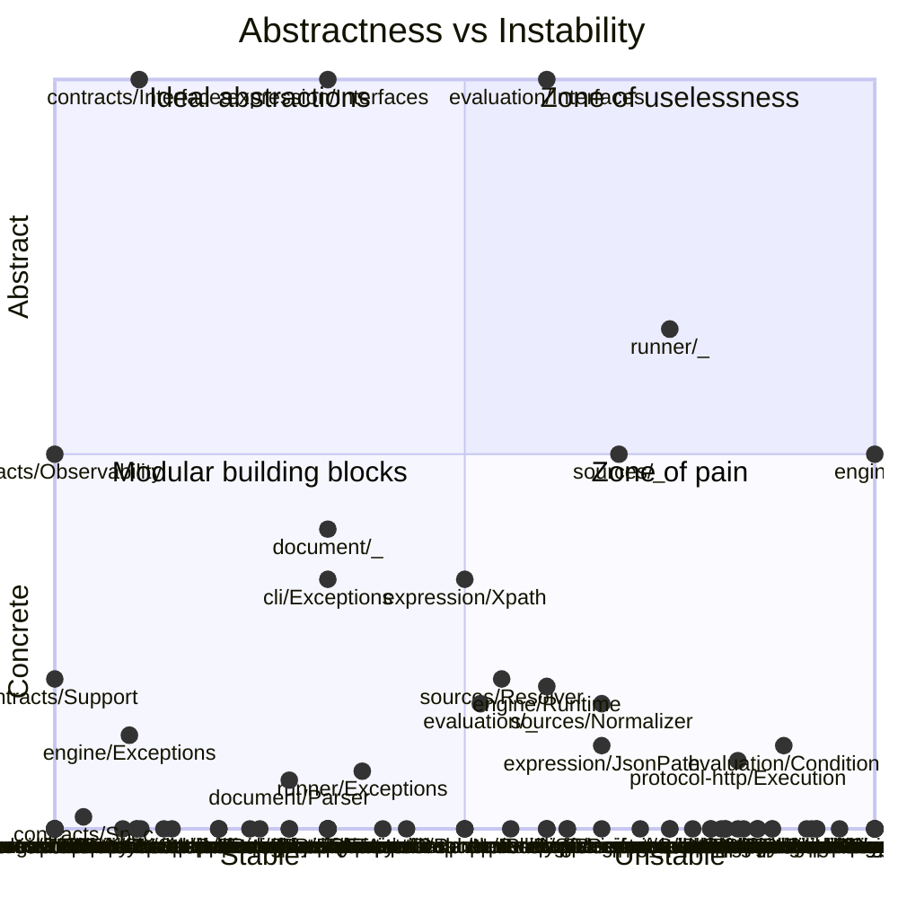

<!-- GENERATED by scripts/generate-docs.php — DO NOT EDIT.
     Refreshed automatically on every commit (see .githooks/pre-commit). -->

# Generated: SOLID Metrics

Uncle Bob's structural health check, computed live:

1. **Abstractness × Instability** — the classic design balance chart. Bottom-right
   ("zone of pain"): concrete modules everything depends on. Top-left
   ("zone of uselessness"): abstractions nobody uses.
2. **God classes** — single types absorbing too much responsibility (SRP).
3. **Fat interfaces** — contracts demanding more than clients need (ISP).
4. **Concrete hubs** — heavily depended-upon modules offering no abstraction (DIP).

## Design balance

## God classes (SRP)

Concrete types over 300 LOC:

| Class | Module | LOC |
|---|---|---:|
| `ExecutionContext` | `engine:Runtime` | 553 |
| `WorkflowContext` | `contracts:State` | 544 |
| `WorkflowExecutor` | `runner:Sync` | 519 |
| `ExecutionState` | `contracts:State` | 511 |
| `StepExecutionWorker` | `runner:Async` | 387 |
| `StepOutcomeHandler` | `runner:Async` | 366 |
| `DefaultOpenApiExecutor` | `protocol-http:Execution` | 323 |
| `WorkflowEngine` | `runner:Sync` | 309 |

## Fat interfaces (ISP)

Contracts declaring more than 7 methods:

| Interface | Methods |
|---|---:|
| `WorkflowContextInterface` <small>contracts</small> | 16 |
| `AsyncRunnerInterface` <small>runner</small> | 16 |
| `ExpressionEngineInterface` <small>expression</small> | 14 |
| `EvaluationInputInterface` <small>expression</small> | 12 |
| `SourcesInterface` <small>sources</small> | 11 |
| `RunnerInterface` <small>runner</small> | 10 |
| `ExecutionStoreInterface` <small>runner</small> | 9 |
| `EvaluationEngineInterface` <small>evaluation</small> | 8 |

## Concrete hubs (DIP)

Modules depended upon by ≥4 others while offering no interface:

| Module | Fan-in | Classes | Interfaces |
|---|---:|---:|---:|
| — | — | — | 0 |
