<!-- GENERATED by scripts/generate-docs.php — DO NOT EDIT.
     Refreshed automatically on every commit (see .githooks/pre-commit). -->

# Generated: Subdomain Map

Strategic classification: where does this codebase invest, and should it?
Classification is a **declared seed** (edit `SUBDOMAINS` when strategy
changes); LOC and module membership are always scanned live — the numbers keep
the declaration honest.

- **Core domain** — the reason this package exists; hand-written, heavily tested.
- **Supporting** — necessary domain work, less differentiation.
- **Generic** — solved problems; adapters over frameworks. Buy, don't build.

```mermaid
flowchart LR
    subgraph S_core["Core domain"]
        S_contracts_Spec["contracts:Spec<br/><small>1279 LOC</small>"]:::coreDomain
    end
    subgraph S_supporting["Supporting"]
        S_cli_Console["cli:Console<br/><small>939 LOC</small>"]:::supportingDomain
        S_cli_Generator["cli:Generator<br/><small>141 LOC</small>"]:::supportingDomain
        S_cli_Renderer["cli:Renderer<br/><small>255 LOC</small>"]:::supportingDomain
        S_document_Parser["document:Parser<br/><small>2241 LOC</small>"]:::supportingDomain
        S_document_Validator["document:Validator<br/><small>3779 LOC</small>"]:::supportingDomain
        S_protocol_http_Resolver["protocol-http:Resolver<br/><small>285 LOC</small>"]:::supportingDomain
        S_protocol_soap_Resolver["protocol-soap:Resolver<br/><small>136 LOC</small>"]:::supportingDomain
        S_sources_Resolver["sources:Resolver<br/><small>478 LOC</small>"]:::supportingDomain
    end
    subgraph S_generic["Generic subdomain"]
        S_contracts_State["contracts:State<br/><small>977 LOC</small>"]:::genericDomain
        S_contracts_Support["contracts:Support<br/><small>185 LOC</small>"]:::genericDomain
        S_evaluation_Events["evaluation:Events<br/><small>27 LOC</small>"]:::genericDomain
        S_expression_Support["expression:Support<br/><small>59 LOC</small>"]:::genericDomain
        S_runner_Events["runner:Events<br/><small>328 LOC</small>"]:::genericDomain
    end
    subgraph S_unclassified["Unclassified"]
        S_contracts_Attributes["contracts:Attributes<br/><small>105 LOC</small>"]:::unknownDomain
        S_contracts_Data["contracts:Data<br/><small>155 LOC</small>"]:::unknownDomain
        S_contracts_Dependency["contracts:Dependency<br/><small>336 LOC</small>"]:::unknownDomain
        S_contracts_Discovery["contracts:Discovery<br/><small>294 LOC</small>"]:::unknownDomain
        S_contracts_Exceptions["contracts:Exceptions<br/><small>31 LOC</small>"]:::unknownDomain
        S_contracts_Interfaces["contracts:Interfaces<br/><small>412 LOC</small>"]:::unknownDomain
        S_contracts_Validation["contracts:Validation<br/><small>331 LOC</small>"]:::unknownDomain
        S_document_Registries["document:Registries<br/><small>94 LOC</small>"]:::unknownDomain
        S_engine_Data["engine:Data<br/><small>74 LOC</small>"]:::unknownDomain
        S_engine_Enum["engine:Enum<br/><small>17 LOC</small>"]:::unknownDomain
        S_engine_Exceptions["engine:Exceptions<br/><small>42 LOC</small>"]:::unknownDomain
        S_engine_Execution["engine:Execution<br/><small>1031 LOC</small>"]:::unknownDomain
        S_engine_Runtime["engine:Runtime<br/><small>1639 LOC</small>"]:::unknownDomain
        S_evaluation_Condition["evaluation:Condition<br/><small>1023 LOC</small>"]:::unknownDomain
        S_evaluation_Data["evaluation:Data<br/><small>86 LOC</small>"]:::unknownDomain
        S_evaluation_Enum["evaluation:Enum<br/><small>123 LOC</small>"]:::unknownDomain
        S_evaluation_Interfaces["evaluation:Interfaces<br/><small>44 LOC</small>"]:::unknownDomain
        S_evaluation_Plugins["evaluation:Plugins<br/><small>124 LOC</small>"]:::unknownDomain
        S_evaluation_Registries["evaluation:Registries<br/><small>219 LOC</small>"]:::unknownDomain
        S_expression_Ast["expression:Ast<br/><small>355 LOC</small>"]:::unknownDomain
        S_expression_Data["expression:Data<br/><small>198 LOC</small>"]:::unknownDomain
        S_expression_Enum["expression:Enum<br/><small>47 LOC</small>"]:::unknownDomain
        S_expression_Exceptions["expression:Exceptions<br/><small>64 LOC</small>"]:::unknownDomain
        S_expression_Interfaces["expression:Interfaces<br/><small>208 LOC</small>"]:::unknownDomain
        S_expression_Internal["expression:Internal<br/><small>433 LOC</small>"]:::unknownDomain
        S_expression_JsonPath["expression:JsonPath<br/><small>1378 LOC</small>"]:::unknownDomain
        S_expression_Plugins["expression:Plugins<br/><small>134 LOC</small>"]:::unknownDomain
        S_expression_Registries["expression:Registries<br/><small>130 LOC</small>"]:::unknownDomain
        S_expression_Validation["expression:Validation<br/><small>1412 LOC</small>"]:::unknownDomain
        S_expression_Xpath["expression:Xpath<br/><small>173 LOC</small>"]:::unknownDomain
        S_protocol_http_Execution["protocol-http:Execution<br/><small>536 LOC</small>"]:::unknownDomain
        S_protocol_http_Protocol["protocol-http:Protocol<br/><small>333 LOC</small>"]:::unknownDomain
        S_protocol_rpc_Execution["protocol-rpc:Execution<br/><small>315 LOC</small>"]:::unknownDomain
        S_protocol_rpc_Normalizer["protocol-rpc:Normalizer<br/><small>663 LOC</small>"]:::unknownDomain
        S_protocol_rpc_Protocol["protocol-rpc:Protocol<br/><small>514 LOC</small>"]:::unknownDomain
        S_protocol_rpc_Transfer["protocol-rpc:Transfer<br/><small>219 LOC</small>"]:::unknownDomain
        S_protocol_rpc_Validation["protocol-rpc:Validation<br/><small>79 LOC</small>"]:::unknownDomain
        S_protocol_soap_Exceptions["protocol-soap:Exceptions<br/><small>16 LOC</small>"]:::unknownDomain
        S_protocol_soap_Execution["protocol-soap:Execution<br/><small>599 LOC</small>"]:::unknownDomain
        S_protocol_soap_Normalizer["protocol-soap:Normalizer<br/><small>446 LOC</small>"]:::unknownDomain
        S_protocol_soap_Transfer["protocol-soap:Transfer<br/><small>203 LOC</small>"]:::unknownDomain
        S_protocol_soap_Validation["protocol-soap:Validation<br/><small>353 LOC</small>"]:::unknownDomain
        S_runner_Async["runner:Async<br/><small>1351 LOC</small>"]:::unknownDomain
        S_runner_Exceptions["runner:Exceptions<br/><small>20 LOC</small>"]:::unknownDomain
        S_runner_Execution["runner:Execution<br/><small>384 LOC</small>"]:::unknownDomain
        S_runner_Interfaces["runner:Interfaces<br/><small>25 LOC</small>"]:::unknownDomain
        S_runner_Preflight["runner:Preflight<br/><small>150 LOC</small>"]:::unknownDomain
        S_runner_Sync["runner:Sync<br/><small>1082 LOC</small>"]:::unknownDomain
        S_sources_Exceptions["sources:Exceptions<br/><small>65 LOC</small>"]:::unknownDomain
        S_sources_Normalizer["sources:Normalizer<br/><small>592 LOC</small>"]:::unknownDomain
        S_sources_Registries["sources:Registries<br/><small>98 LOC</small>"]:::unknownDomain
    end
    classDef coreDomain fill:#e6f4ea,stroke:#34a853,color:#1a1a1a;
    classDef supportingDomain fill:#e8f0fe,stroke:#4285f4,color:#1a1a1a;
    classDef genericDomain fill:#f1f3f4,stroke:#9aa0a6,color:#1a1a1a;
    classDef unknownDomain fill:#fce8e6,stroke:#ea4335,color:#1a1a1a;
```

| Subdomain | Modules | Core pkg LOC | Laravel pkg LOC | Share |
|---|---:|---:|---:|---:|
| Core domain | 1 | 1,279 | 0 | 4% |
| Supporting | 8 | 8,254 | 0 | 28% |
| Generic subdomain | 5 | 1,576 | 0 | 5% |
| Unclassified | 51 | 18,755 | 0 | 63% |

**Unclassified modules** — classify them in `SUBDOMAINS` or delete them:
- `contracts:Attributes`
- `contracts:Data`
- `contracts:Dependency`
- `contracts:Discovery`
- `contracts:Exceptions`
- `contracts:Interfaces`
- `contracts:Validation`
- `document:Registries`
- `engine:Data`
- `engine:Enum`
- `engine:Exceptions`
- `engine:Execution`
- `engine:Runtime`
- `evaluation:Condition`
- `evaluation:Data`
- `evaluation:Enum`
- `evaluation:Interfaces`
- `evaluation:Plugins`
- `evaluation:Registries`
- `expression:Ast`
- `expression:Data`
- `expression:Enum`
- `expression:Exceptions`
- `expression:Interfaces`
- `expression:Internal`
- `expression:JsonPath`
- `expression:Plugins`
- `expression:Registries`
- `expression:Validation`
- `expression:Xpath`
- `protocol-http:Execution`
- `protocol-http:Protocol`
- `protocol-rpc:Execution`
- `protocol-rpc:Normalizer`
- `protocol-rpc:Protocol`
- `protocol-rpc:Transfer`
- `protocol-rpc:Validation`
- `protocol-soap:Exceptions`
- `protocol-soap:Execution`
- `protocol-soap:Normalizer`
- `protocol-soap:Transfer`
- `protocol-soap:Validation`
- `runner:Async`
- `runner:Exceptions`
- `runner:Execution`
- `runner:Interfaces`
- `runner:Preflight`
- `runner:Sync`
- `sources:Exceptions`
- `sources:Normalizer`
- `sources:Registries`
