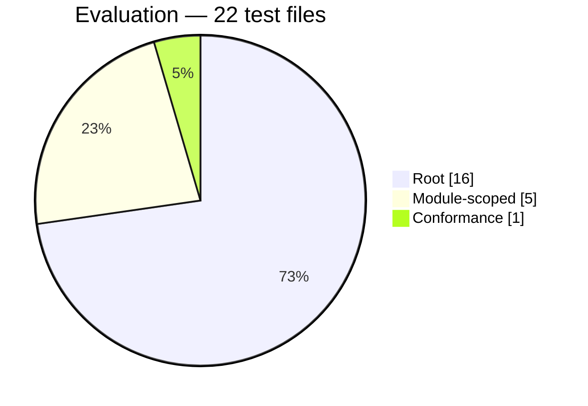
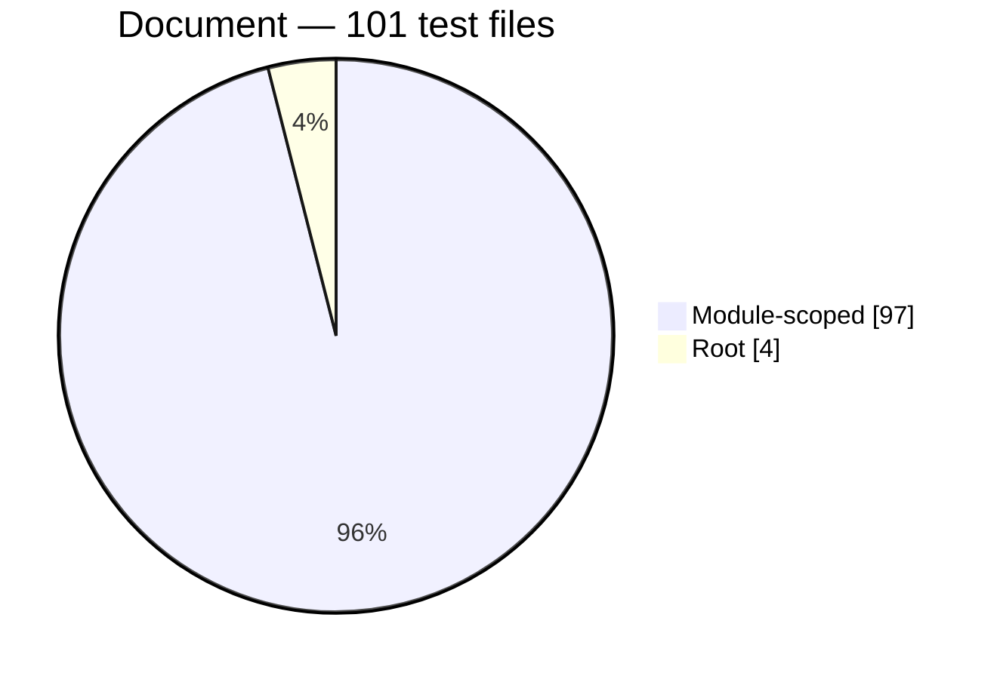
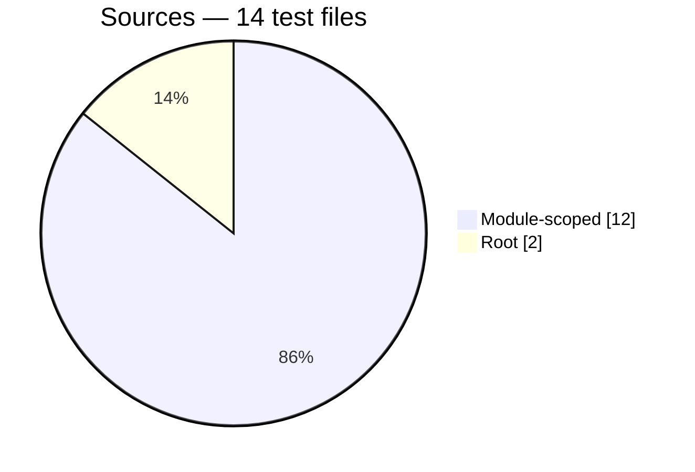
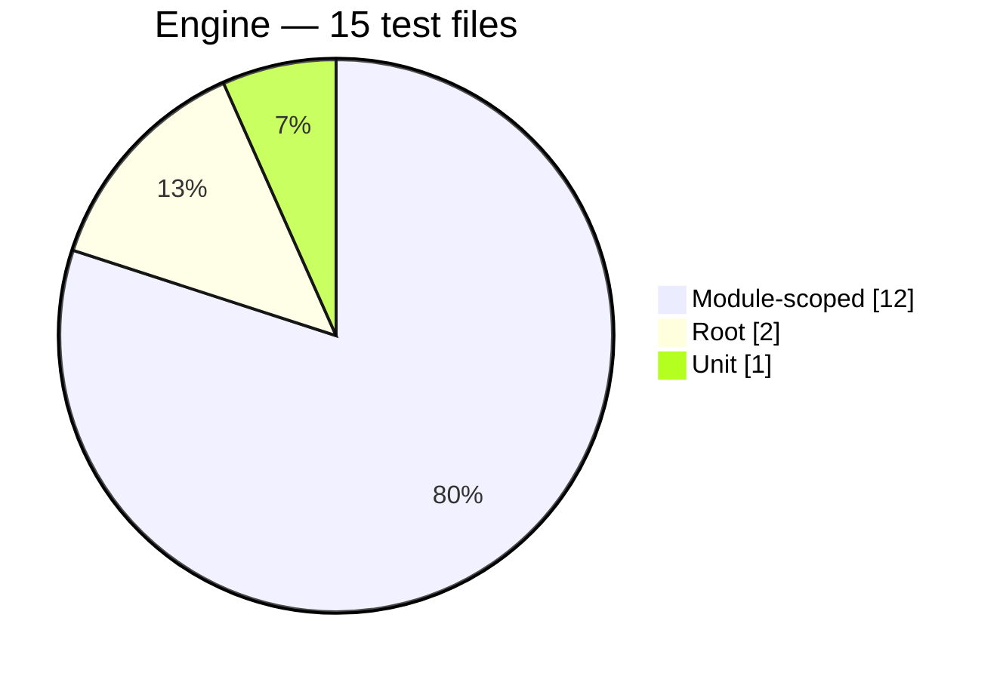
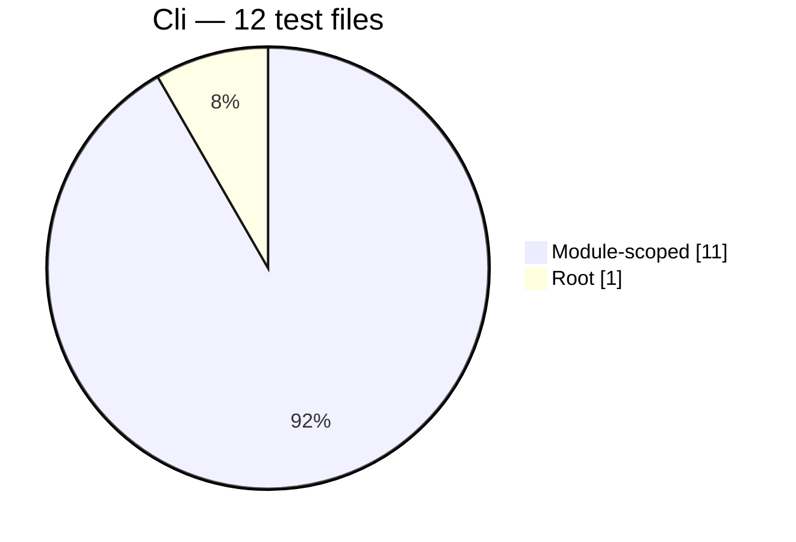
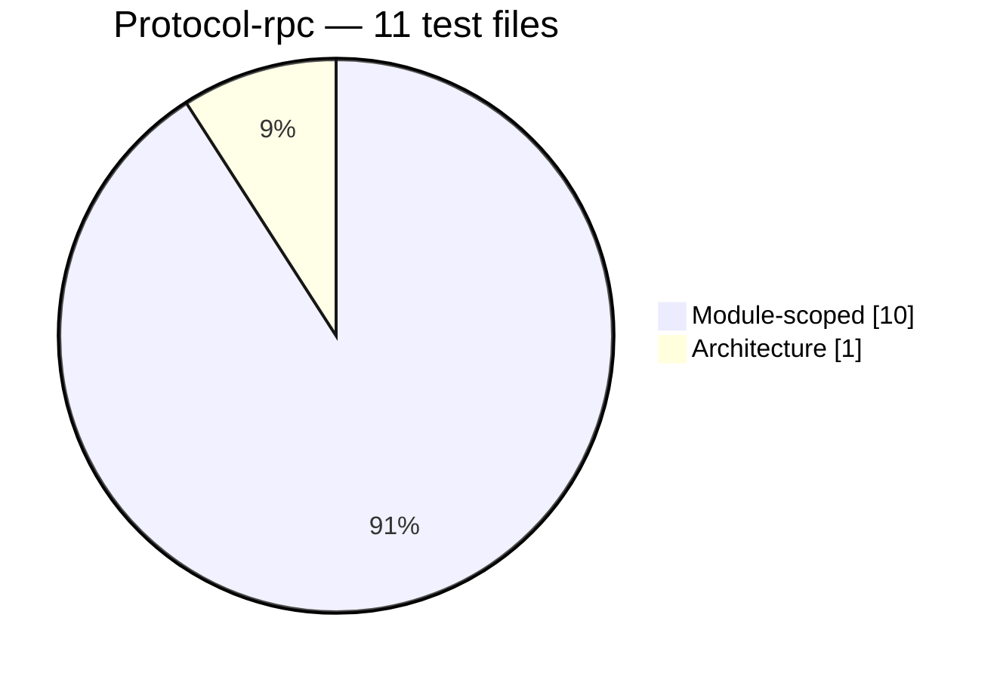
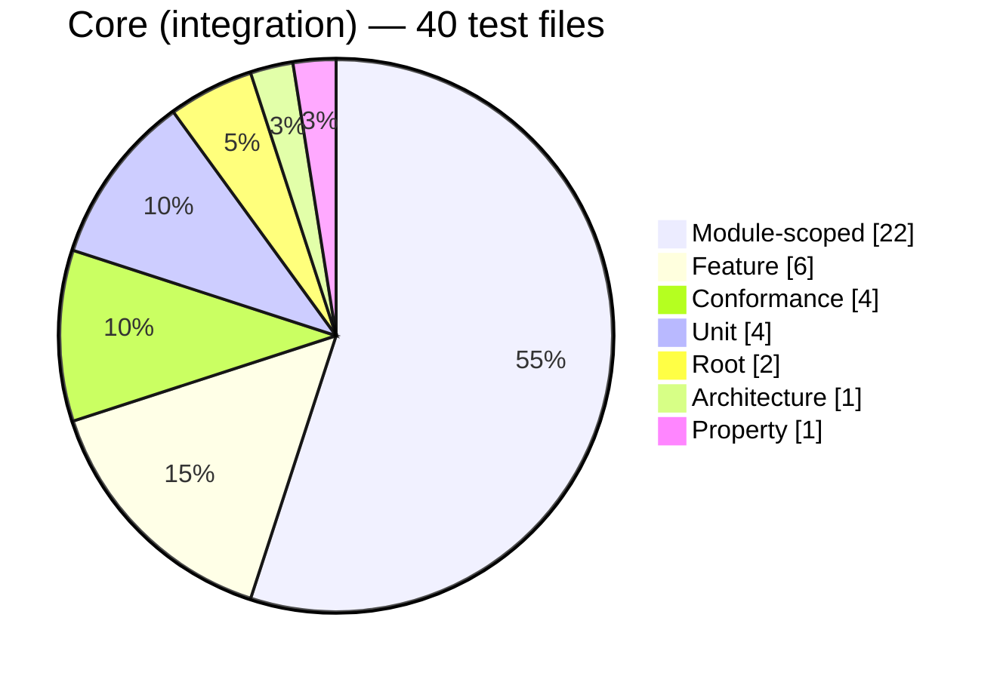

<!-- GENERATED by scripts/generate-docs.php — DO NOT EDIT.
     Refreshed automatically on every commit (see .githooks/pre-commit). -->

# Generated: Test Suite Composition

Shape of the reliability evidence, counted by test file (`*Test.php`) per
suite directory in `packages/*/tests`. A healthy package usually shows a wide
unit base, a deliberate feature layer, and a conformance slice proving spec
compliance — not an inverted pyramid of end-to-end tests.

## Contracts package

| Suite | Files | Share |
|---|---:|---:|
| Module-scoped | 40 | 95% |
| Root | 1 | 2% |
| Unit | 1 | 2% |

## Expression package

| Suite | Files | Share |
|---|---:|---:|
| Module-scoped | 24 | 80% |
| Conformance | 4 | 13% |
| Root | 2 | 7% |

## Evaluation package

| Suite | Files | Share |
|---|---:|---:|
| Root | 16 | 73% |
| Module-scoped | 5 | 23% |
| Conformance | 1 | 5% |

## Document package

| Suite | Files | Share |
|---|---:|---:|
| Module-scoped | 97 | 96% |
| Root | 4 | 4% |

## Sources package

| Suite | Files | Share |
|---|---:|---:|
| Module-scoped | 12 | 86% |
| Root | 2 | 14% |

## Engine package

| Suite | Files | Share |
|---|---:|---:|
| Module-scoped | 12 | 80% |
| Root | 2 | 13% |
| Unit | 1 | 7% |

## Runner package

| Suite | Files | Share |
|---|---:|---:|
| Module-scoped | 46 | 87% |
| Root | 7 | 13% |

## Cli package

| Suite | Files | Share |
|---|---:|---:|
| Module-scoped | 11 | 92% |
| Root | 1 | 8% |

## Protocol-http package

| Suite | Files | Share |
|---|---:|---:|
| Module-scoped | 10 | 83% |
| Architecture | 1 | 8% |
| Root | 1 | 8% |

## Protocol-rpc package

| Suite | Files | Share |
|---|---:|---:|
| Module-scoped | 10 | 91% |
| Architecture | 1 | 9% |

## Protocol-soap package

| Suite | Files | Share |
|---|---:|---:|
| Module-scoped | 10 | 91% |
| Architecture | 1 | 9% |

## Core package

| Suite | Files | Share |
|---|---:|---:|
| Module-scoped | 22 | 55% |
| Feature | 6 | 15% |
| Conformance | 4 | 10% |
| Unit | 4 | 10% |
| Root | 2 | 5% |
| Architecture | 1 | 2% |
| Property | 1 | 2% |

## Core (integration) package

| Suite | Files | Share |
|---|---:|---:|
| Module-scoped | 22 | 55% |
| Feature | 6 | 15% |
| Conformance | 4 | 10% |
| Unit | 4 | 10% |
| Root | 2 | 5% |
| Architecture | 1 | 2% |
| Property | 1 | 2% |

## Laravel package

_No test files found._
