<!-- GENERATED by scripts/generate-docs.php — DO NOT EDIT.
     Refreshed automatically on every commit (see .githooks/pre-commit). -->

# Generated: Test Suite Composition

Shape of the reliability evidence, counted by test file (`*Test.php`) per
suite directory in `packages/*/tests`. A healthy package usually shows a wide
unit base, a deliberate feature layer, and a conformance slice proving spec
compliance — not an inverted pyramid of end-to-end tests.

## Contracts package

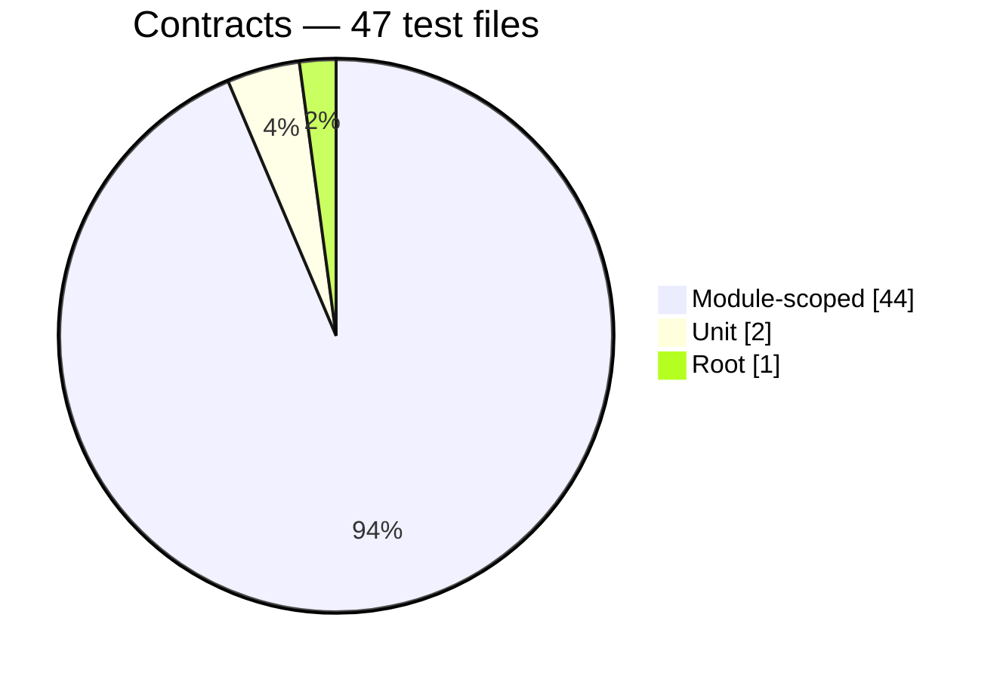

| Suite | Files | Share |
|---|---:|---:|
| Module-scoped | 44 | 94% |
| Unit | 2 | 4% |
| Root | 1 | 2% |

## Expression package

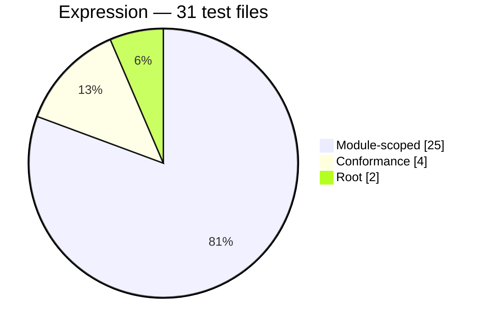

| Suite | Files | Share |
|---|---:|---:|
| Module-scoped | 25 | 81% |
| Conformance | 4 | 13% |
| Root | 2 | 6% |

## Evaluation package

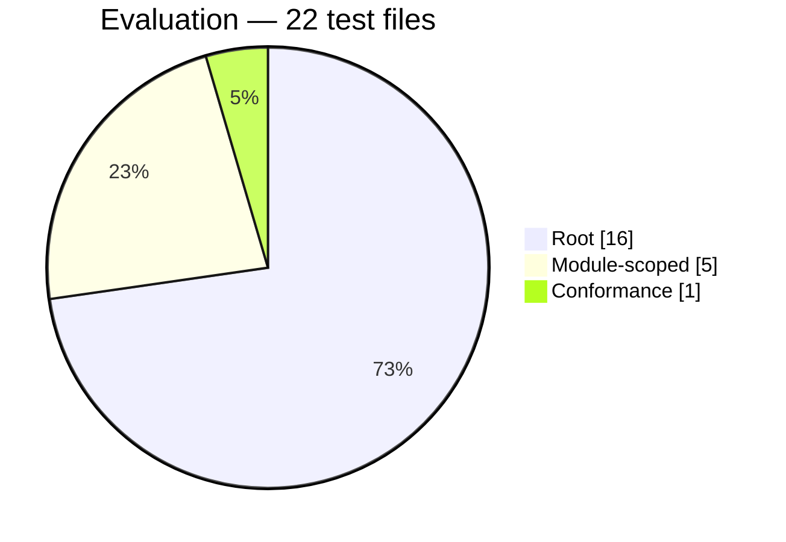

| Suite | Files | Share |
|---|---:|---:|
| Root | 16 | 73% |
| Module-scoped | 5 | 23% |
| Conformance | 1 | 5% |

## Document package

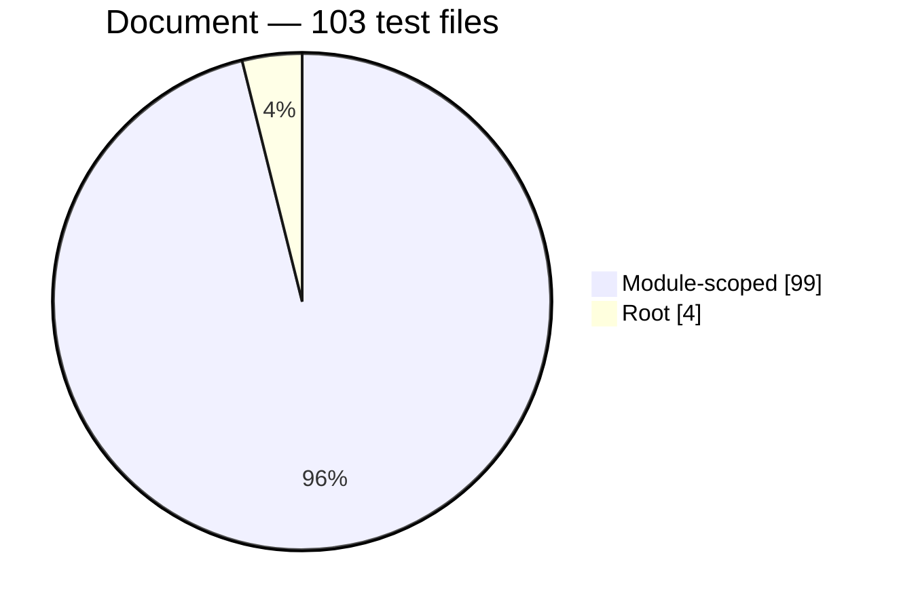

| Suite | Files | Share |
|---|---:|---:|
| Module-scoped | 99 | 96% |
| Root | 4 | 4% |

## Sources package

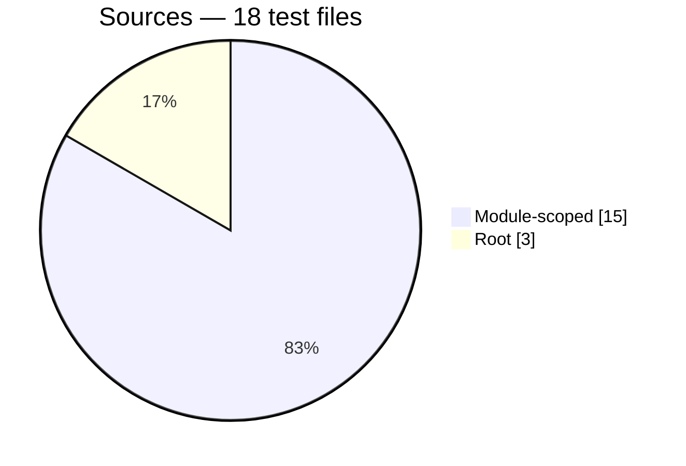

| Suite | Files | Share |
|---|---:|---:|
| Module-scoped | 15 | 83% |
| Root | 3 | 17% |

## Engine package

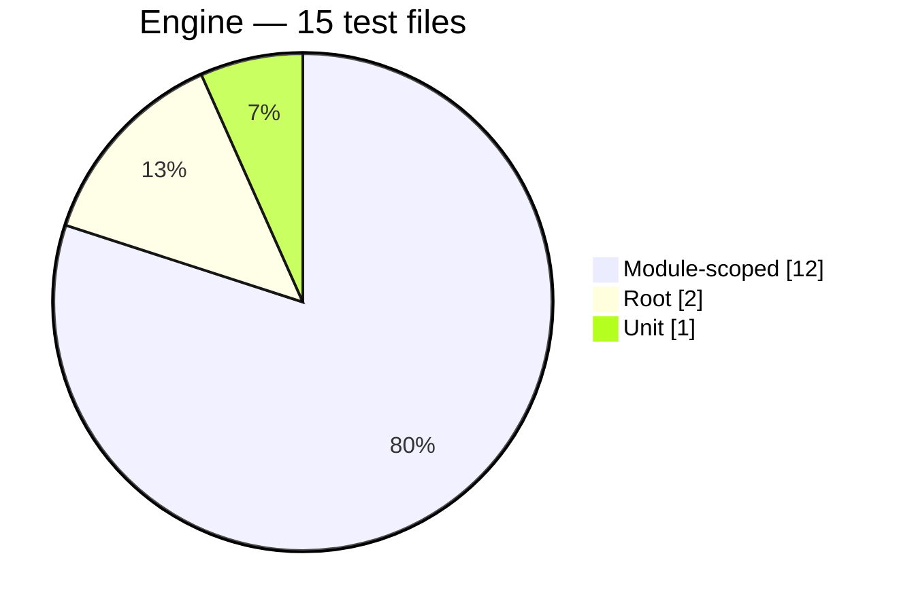

| Suite | Files | Share |
|---|---:|---:|
| Module-scoped | 12 | 80% |
| Root | 2 | 13% |
| Unit | 1 | 7% |

## Runner package

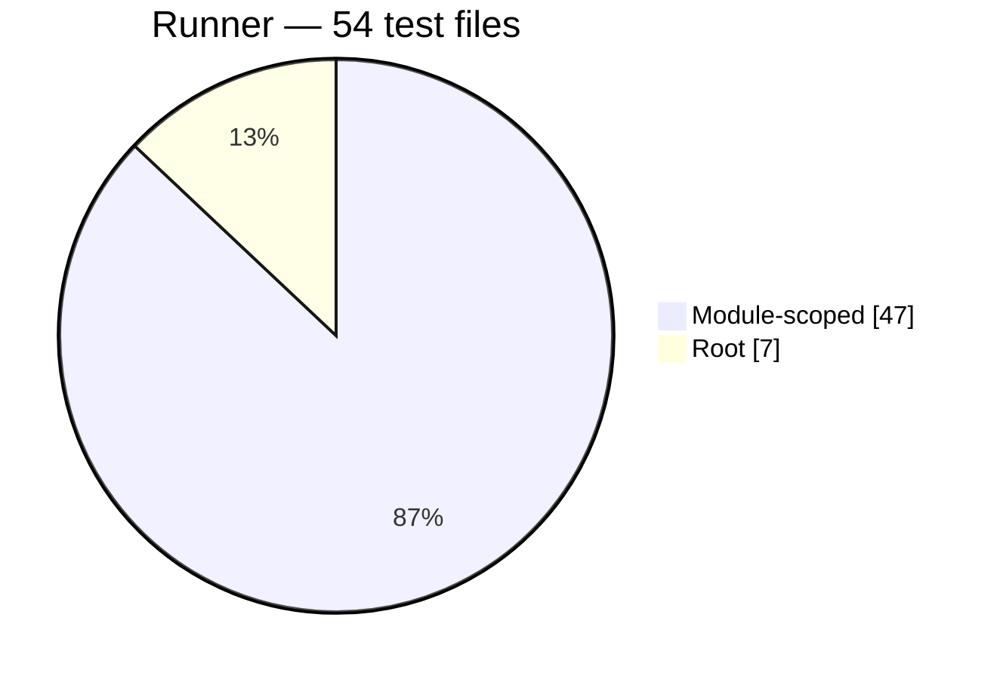

| Suite | Files | Share |
|---|---:|---:|
| Module-scoped | 47 | 87% |
| Root | 7 | 13% |

## Cli package

| Suite | Files | Share |
|---|---:|---:|
| Module-scoped | 13 | 93% |
| Root | 1 | 7% |

## Protocol-http package

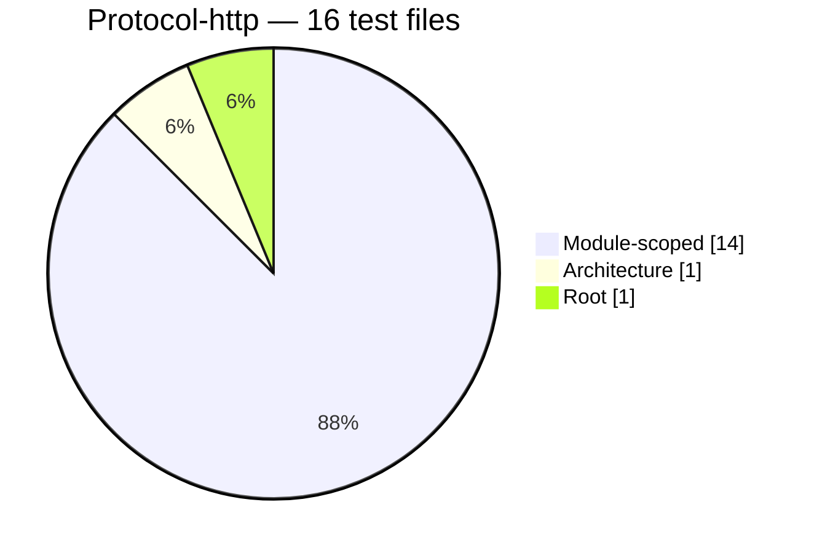

| Suite | Files | Share |
|---|---:|---:|
| Module-scoped | 14 | 88% |
| Architecture | 1 | 6% |
| Root | 1 | 6% |

## Protocol-rpc package

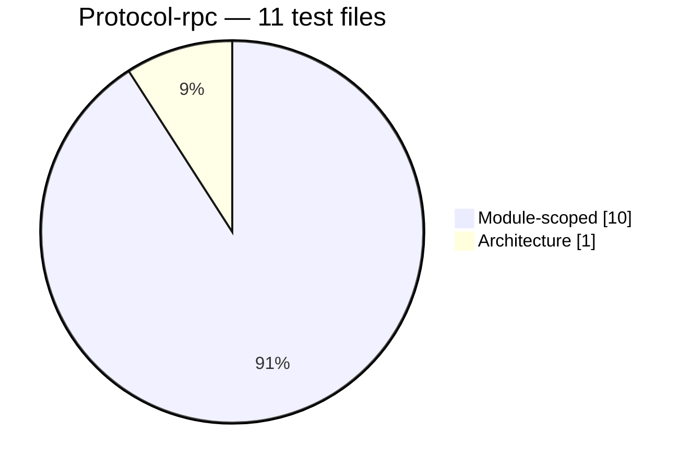

| Suite | Files | Share |
|---|---:|---:|
| Module-scoped | 10 | 91% |
| Architecture | 1 | 9% |

## Protocol-soap package

| Suite | Files | Share |
|---|---:|---:|
| Module-scoped | 10 | 91% |
| Architecture | 1 | 9% |

## Core package

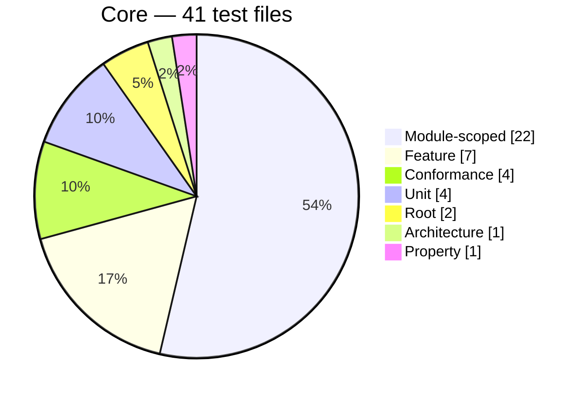

| Suite | Files | Share |
|---|---:|---:|
| Module-scoped | 22 | 54% |
| Feature | 7 | 17% |
| Conformance | 4 | 10% |
| Unit | 4 | 10% |
| Root | 2 | 5% |
| Architecture | 1 | 2% |
| Property | 1 | 2% |

## Core (integration) package

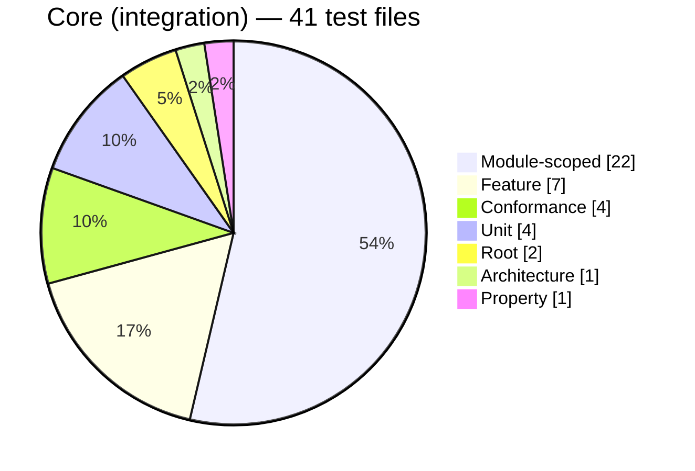

| Suite | Files | Share |
|---|---:|---:|
| Module-scoped | 22 | 54% |
| Feature | 7 | 17% |
| Conformance | 4 | 10% |
| Unit | 4 | 10% |
| Root | 2 | 5% |
| Architecture | 1 | 2% |
| Property | 1 | 2% |

## Laravel package

_No test files found._
