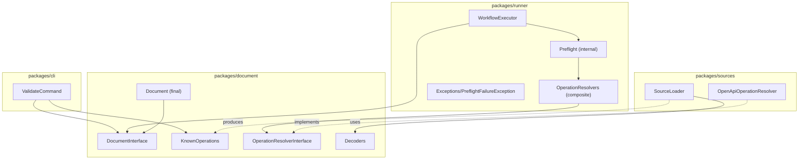

# Design Spec: Document Package Redesign & Public Interface

## 1. Intent & Context

The `alama/arazzo-document` package currently suffers from structural design issues and leaky boundaries:
1. **`ModelStack` anti-pattern**: `ModelStack` acts as a passive service locator/bag-of-collaborators that aggregates `Loader`, `Parser`, `Validator`, `ExpressionEngineInterface`, `PreflightValidator`, and `OpenApiOperationResolverInterface`. It provides no encapsulation; consumers reach into its public properties, and dependencies are duplicated.
2. **Boundary and dependency inversion**: `document` imports types from `sources` (`PreflightValidator`, `OpenApiOperationResolverInterface`) even though `document/composer.json` does not and cannot depend on `sources`.
3. **Leaky and bloated interface**: `DocumentInterface` conflates pure AST/parsing/validation operations (`load`, `loadFromYaml`, `loadFromJson`, `validate`) with network/source-bound operations (`preflight`, `resolveOperation`) and mutative builder methods (`withDecodePolicy`).
4. **Duplicate SPIs**: `Alama\Arazzo\Document\OperationResolverInterface` and `Alama\Arazzo\Sources\Normalizer\OpenApiOperationResolverInterface` exist concurrently to solve the same problem.
5. **Validator leak**: `Validator` is marked `@internal`, yet `cli` and `sources` instantiate it directly because `DocumentInterface::validate()` provides no typed mechanism to pass known resolved operations.

This design cleanses `alama/arazzo-document`, establishes a strict public API allow-list enforced by an architecture test, eliminates `ModelStack`, extracts preflight execution to `runner`, and streamlines operation resolution contracts.

---

## 2. Settled Decisions (Design Tree)

- **Scope**: Redesign `document` package boundaries first, providing a clean blueprint for other packages.
- **`ModelStack`**: Deleted. Replaced with direct constructor injection in `Document` and a zero-argument static factory `Document::create()`.
- **`DocumentInterface`**: Stripped of I/O operations (`preflight`, `resolveOperation`) and builder mutators (`withDecodePolicy`). Retains only pure parsing, validation, and workflow input validation.
- **Workflow Inputs Validation**: `validateInputs()` is pure schema validation (2020-12 JSON Schema) without external source dependencies; it lives on `Document` and `DocumentInterface`.
- **Preflight Extraction**: Preflight is protocol-aware execution validation that belongs exclusively to `runner` (`Alama\Arazzo\Runner\Preflight\Preflight`). `PreflightValidator` and `PreflightInterface` are removed from `sources` and `document`.
- **Operation Resolvers**: Consolidated into a single protocol-agnostic contract: `Alama\Arazzo\Document\OperationResolverInterface`. `OpenApiOperationResolverInterface` is deleted.
- **Known Operations**: Untyped `array<string, array<string, true>>` is replaced by the immutable value object `Alama\Arazzo\Document\KnownOperations`.
- **Decoder Seam**: Public `DecoderInterface` and factory `Decoders::for(Format $format, ?DecodePolicy $policy = null)`. Concrete decoders are marked `@internal`.
- **Exceptions**: `PreflightFailureException` moves to `packages/runner/src/Exceptions/PreflightFailureException.php`.

---

## 3. Public API Surface (`alama/arazzo-document`)

Only the following symbols constitute the public API of `alama/arazzo-document`:

### 3.1 Primary Facade & Interface

```php
namespace Alama\Arazzo\Document;

use Alama\Arazzo\Contracts\Spec\ArazzoDocument;
use Alama\Arazzo\Document\Parser\DecodePolicy;
use Alama\Arazzo\Document\Parser\Exceptions\LoaderException;
use Alama\Arazzo\Document\Parser\Exceptions\ParserException;
use Alama\Arazzo\Document\Validator\Data\ValidationResult;

interface DocumentInterface
{
    /**
     * Load and parse an Arazzo document from a file path.
     *
     * @throws LoaderException
     * @throws ParserException
     */
    public function load(string $path): ArazzoDocument;

    /**
     * Load and parse an Arazzo document from raw YAML string.
     *
     * @throws LoaderException
     * @throws ParserException
     */
    public function loadFromYaml(string $content, string $virtualPath = 'inline.yaml'): ArazzoDocument;

    /**
     * Load and parse an Arazzo document from raw JSON string.
     *
     * @throws LoaderException
     * @throws ParserException
     */
    public function loadFromJson(string $content, string $virtualPath = 'inline.json'): ArazzoDocument;

    /**
     * Validate an Arazzo document against spec rules and optional known operations.
     */
    public function validate(ArazzoDocument $document, ?KnownOperations $operations = null): ValidationResult;

    /**
     * Validate runtime inputs against a workflow's declared JSON Schema (2020-12).
     *
     * @param array<string, mixed> $inputs
     */
    public function validateInputs(ArazzoDocument $document, string $workflowId, array $inputs): ValidationResult;
}

final readonly class Document implements DocumentInterface
{
    private function __construct(
        private Loader $loader,
        private Parser $parser,
        private Validator $validator,
    ) {}

    public static function create(): self;

    public function withDecodePolicy(DecodePolicy $policy): self;

    public function load(string $path): ArazzoDocument;
    public function loadFromYaml(string $content, string $virtualPath = 'inline.yaml'): ArazzoDocument;
    public function loadFromJson(string $content, string $virtualPath = 'inline.json'): ArazzoDocument;
    public function validate(ArazzoDocument $document, ?KnownOperations $operations = null): ValidationResult;
    public function validateInputs(ArazzoDocument $document, string $workflowId, array $inputs): ValidationResult;
}
```

### 3.2 Known Operations Value Object

```php
namespace Alama\Arazzo\Document;

final readonly class KnownOperations
{
    /**
     * @param array<string, array<string, true>> $operations [sourceName => [operationId => true]]
     */
    public function __construct(
        private array $operations = [],
    ) {}

    public static function none(): self;

    /**
     * @param list<string> $operationIds
     */
    public function withSource(string $source, array $operationIds): self;

    public function covers(string $source): bool;

    public function has(string $source, string $operationId): bool;

    /**
     * @return array<string, array<string, true>>
     */
    public function toArray(): array;
}
```

### 3.3 Protocol Operation Resolution SPI

```php
namespace Alama\Arazzo\Document;

use Alama\Arazzo\Contracts\Spec\ArazzoDocument;
use Alama\Arazzo\Contracts\Spec\Step;

interface OperationResolverInterface
{
    public function supportsStep(Step $step, ArazzoDocument $document): bool;

    public function resolve(Step $step, ArazzoDocument $document): ResolvedOperation;
}
```

DTOs:
- `Alama\Arazzo\Document\ResolvedOperation`
- `Alama\Arazzo\Document\NormalizedOpenApiOperation`

### 3.4 Decoders SPI & Factory

```php
namespace Alama\Arazzo\Document\Parser;

use Alama\Arazzo\Contracts\Spec\Enum\Format;
use Alama\Arazzo\Document\Parser\Interfaces\DecoderInterface;

final readonly class Decoders
{
    public static function for(Format $format, ?DecodePolicy $policy = null): DecoderInterface;
}
```

- Public Interface: `Alama\Arazzo\Document\Parser\Interfaces\DecoderInterface`
- Public Config: `Alama\Arazzo\Document\Parser\DecodePolicy`
- Concrete Decoders (`NativeJsonDecoder`, `SymfonyYamlDecoder`, `YamlNodeRangeScanner`, `YamlSecurityScanner`) are marked `@internal`.

### 3.5 Diagnostic & Validation Data Models

- `Alama\Arazzo\Document\Validator\Data\ValidationResult`
- `Alama\Arazzo\Document\Validator\Data\Error`
- `Alama\Arazzo\Document\Validator\Data\Warning`
- `Alama\Arazzo\Document\Validator\Enum\Severity`

All other validator classes (`Validator`, `RuleSet`, `Rule`, `SymbolTable`, `ErrorCollector`, `WorkflowSymbols`, individual rule implementations) are marked `@internal`.

### 3.6 Exceptions

- `Alama\Arazzo\Document\Parser\Exceptions\LoaderException`
- `Alama\Arazzo\Document\Parser\Exceptions\ParserException` (and spec syntax/limit subclasses)
- `Alama\Arazzo\Document\Parser\Exceptions\DecodeException`

---

## 4. Cross-Package Interactions



### 4.1 Sources Package Changes
1. `Alama\Arazzo\Sources\Normalizer\OpenApiOperationResolver`:
   - Implements `Alama\Arazzo\Document\OperationResolverInterface`.
   - `supportsStep(Step $step, ArazzoDocument $document): bool` checks if the step target references an OpenAPI source.
   - `resolve(Step $step, ArazzoDocument $document): ResolvedOperation` loads and normalizes the target operation.
   - Validates supported OpenAPI versions (`2.0`, `3.0`, `3.1`), throwing resolution exceptions on unsupported versions.
2. `Alama\Arazzo\Sources\Normalizer\OpenApiOperationResolverInterface`: Deleted.
3. `Alama\Arazzo\Sources\Validator\PreflightValidator`: Deleted.
4. `Alama\Arazzo\Sources\SourceLoader`: Exposes `public function knownOperations(): KnownOperations`.
5. `Alama\Arazzo\Sources\Resolver\DefaultSourceResolver`: Refactored to obtain decoders via `Decoders::for()`.
6. `Alama\Arazzo\Sources\SourceGraph`:
   - Remove `document()` and `using()`.
   - Update `runtime()` to no longer accept `$engine`.

### 4.2 Runner Package Changes
1. New class `Alama\Arazzo\Runner\Preflight\Preflight`:
   - Checks steps against registered `OperationResolvers`.
   - Invokes `resolve()` on the matching resolver.
   - Validates XPath selector versions.
   - Returns `ValidationResult`.
2. New composite `Alama\Arazzo\Runner\Preflight\OperationResolvers`:
   - Accepts `iterable<OperationResolverInterface>`.
   - Iterates through resolvers to find the first that `supportsStep()`.
3. `PreflightFailureException`:
   - Moved to `packages/runner/src/Exceptions/PreflightFailureException.php`.
4. Preflight execution toggle:
   - `RunControlFlow` uses `public bool $preflight = true` (defaults to `true`).
   - If false, preflight check is bypassed without requiring nullable dummy interfaces.

### 4.3 CLI Package Changes
1. `ValidateCommand`:
   - Uses `Document::create()->validate($document, $sourceLoader->knownOperations())`.
   - Ceases direct construction of `Validator` and `RuleSet`.
2. `DocumentLoader`:
   - Uses `Document::create()->load($file)`.

---

## 5. Architectural Invariants & Verification

A Pest architecture test will be added to `packages/document/tests/ArchTest.php` ensuring:
1. No external package imports `@internal` symbols from `Alama\Arazzo\Document\*`.
2. `Alama\Arazzo\Document` has zero dependencies on `Alama\Arazzo\Sources\*`.
3. Only the symbols listed in §3 are accessed by external code.
