# Design Spec: Sources Package Redesign & Public Interface

## 1. Intent & Context

The `alama/arazzo-sources` package currently suffers from structural design issues, leaky boundaries, and unbalanced coupling:
1. **Bag-of-collaborators anti-pattern (`SourceRuntime`)**: Similar to `ModelStack` in `document`, `SourceRuntime` acts as a passive tuple bundling `DocumentInterface`, `SourceLoader`, and `OperationResolverInterface`. Consumers and tests reach into its public properties, creating low cohesion.
2. **Leaky, stateful facade (`SourceGraph`)**: Exposes pass-through methods (`document()`, `using()`) that delegate directly to `DocumentFacade::create()`, violating single responsibility. Furthermore, `SourceGraph` maintains mutable static state (`private static ?SourceLoader $cachedLoader`).
3. **Pervasive intrusive coupling**: External packages (`cli`, `runner`, `protocol-http`, `protocol-soap`, `protocol-rpc`) directly import internal classes (`SourceRegistry`, `DefaultSourceResolver`, `OpenApiOperationResolver`, `OpenApiOperationHandle`, `WsdlSourceNormalizer`, `SourceFetcher`).
4. **Third-party vendor leakage (`cebe/php-openapi`)**: `packages/sources` depends directly on `cebe/php-openapi` and leaks `OpenApiOperationHandle` (carrying `cebe` objects) to `protocol-http` and `runner`.
5. **Coupling to non-standard formats**: `WsdlSourceNormalizer` and `Swagger2Normalizer` live inside `packages/sources`, forcing `protocol-soap` to depend on sources' internal normalizer.
6. **Untyped array boundaries**: `normalizeSources()` returns a raw `array<string, ResolvedOperation>` without a typed collection or query API.
7. **Enterprise framework DI friction**: Neither `sources` nor `document` provide autowirable public constructors with sensible defaults for enterprise containers (Laravel, Symfony, Drupal, Spryker, WordPress).

This design cleanses `alama/arazzo-sources`, establishes a strict public API allow-list enforced by an architecture test, eliminates `SourceRuntime` and `SourceGraph`, extracts `cebe` dependencies to `protocol-http`, extracts WSDL normalization to `protocol-soap`, promotes shared SPIs and DTOs to `contracts`, introduces `ResolvedOperationCollection`, and standardizes enterprise DI surfaces across both `sources` and `document`.

---

## 2. Settled Decisions (Design Tree)

- **Scope**: Redesign `sources` package boundaries, extract protocol-specific resolvers to protocol packages, promote shared SPIs to `contracts`, and standardize enterprise DI for `sources` and `document`.
- **Primary Facade**: `SourceGraph` and `SourceLoader` are replaced by a final readonly facade `Alama\Arazzo\Sources\Sources` implementing `Alama\Arazzo\Sources\SourcesInterface`, with zero-argument factory `Sources::create()`.
- **`SourceRuntime`**: Deleted. Consumers compose `Document::create()` and `Sources::create()` explicitly.
- **`SourceGraph::document()` and `using()`**: Deleted. `sources` ceases re-exporting the `document` package.
- **Zero-Vendor Purity in Sources**: `cebe/php-openapi` is removed from `packages/sources/composer.json`. Sources uses a lightweight, pure-array `OpenApiSourceNormalizer` (backed by `OpenApi30Normalizer` and `OpenApi31Normalizer`) operating strictly on decoded PHP arrays with zero vendor AST dependencies.
- **Protocol Resolver Relocation**: `OpenApiOperationResolver` and `OpenApiOperationHandle` (which require `cebe` ASTs for HTTP step execution) are moved to `packages/protocol-http`.
- **WSDL Normalizer Relocation**: `WsdlSourceNormalizer` is moved to `packages/protocol-soap`. Sources remains strictly format-agnostic.
- **Typed Operation Collection**: `normalizeSources()` returns `Alama\Arazzo\Contracts\Data\ResolvedOperationCollection`, an immutable typed collection with lookup and filtering methods and direct bridge to `KnownOperations`.
- **Contract Promotion**: `SourceFetcherInterface`, `SourceResolverInterface`, `ResolvedOperation`, `NormalizedOpenApiOperation`, and `ResolvedOperationCollection` reside in `packages/contracts` to prevent sibling package coupling.
- **Enterprise Framework DI & Configuration**:
  - `Sources` provides a public constructor with optional interfaces and sensible defaults, autowirable by any PSR-11 / framework container, plus immutable `with*` fluent methods (`withHttpClient`, `withCache`, `withFetcher`, `withNormalizer`, `withDecodePolicy`).
  - `Document` updates its constructor from `private` to `public` with optional `?ExpressionEngineInterface` and `?DecodePolicy`, unlocking direct DI container autowiring.

---

## 3. Public API Surface (`alama/arazzo-sources`)

Only the following symbols constitute the public API of `alama/arazzo-sources`:

### 3.1 Primary Facade & Interface

```php
namespace Alama\Arazzo\Sources;

use Alama\Arazzo\Contracts\Data\ResolvedOperationCollection;
use Alama\Arazzo\Contracts\Interfaces\SourceFetcherInterface;
use Alama\Arazzo\Contracts\Interfaces\SourceNormalizerInterface;
use Alama\Arazzo\Contracts\Interfaces\SourceNormalizerRegistryInterface;
use Alama\Arazzo\Contracts\Interfaces\SourceResolverInterface;
use Alama\Arazzo\Contracts\Spec\ArazzoDocument;
use Alama\Arazzo\Contracts\Spec\SourceDescription;
use Alama\Arazzo\Contracts\Spec\SourceDocument;
use Alama\Arazzo\Document\KnownOperations;
use Alama\Arazzo\Document\Parser\DecodePolicy;
use Psr\Http\Client\ClientInterface;
use Psr\Http\Message\RequestFactoryInterface;
use Psr\SimpleCache\CacheInterface;

interface SourcesInterface
{
    /**
     * Resolve and fetch a source description into a decoded SourceDocument.
     *
     * @throws SourceResolutionException
     */
    public function resolve(SourceDescription $source, string $basePath = ''): SourceDocument;

    /**
     * Normalize all described sources in the Arazzo document into a typed operation collection.
     */
    public function normalizeSources(ArazzoDocument $document, string $basePath = ''): ResolvedOperationCollection;

    /**
     * Extract KnownOperations for static Arazzo document validation.
     */
    public function knownOperations(ArazzoDocument $document, string $basePath = ''): KnownOperations;
}

final readonly class Sources implements SourcesInterface
{
    /**
     * Enterprise container-friendly constructor with sensible defaults.
     */
    public function __construct(
        ?SourceResolverInterface $resolver = null,
        array $normalizers = [],
        array $documents = [],
    ) {}

    public static function create(): self;

    public function withHttpClient(ClientInterface $client, ?RequestFactoryInterface $factory = null): static;

    public function withFetcher(string $scheme, SourceFetcherInterface $fetcher): static;

    public function withNormalizer(SourceNormalizerInterface $normalizer): static;

    public function withDocument(SourceDocument $document): static;

    public function resolve(SourceDescription $source, string $basePath = ''): SourceDocument;

    public function normalizeSources(ArazzoDocument $document, string $basePath = ''): ResolvedOperationCollection;

    public function knownOperations(ArazzoDocument $document, string $basePath = ''): KnownOperations;
}
```

### 3.2 Public Extension Point (`SourceNormalizerRegistry`)

- `Alama\Arazzo\Sources\Registries\SourceNormalizerRegistry` — concrete singleton (`create()` / `reset()`) auto-seeding the zero-vendor `OpenApiSourceNormalizer` and supporting `#[AsSourceNormalizer]`. `Sources` resolves per-instance `withNormalizer()` overrides first and falls back to `SourceNormalizerRegistry::create()->get($type)`. `SourceNormalizerRegistryInterface` is deleted per ADR-007.

### 3.3 Exceptions

- `Alama\Arazzo\Sources\Exceptions\SourceResolutionException` (base exception)
- `Alama\Arazzo\Sources\Exceptions\SourceFetchException`
- `Alama\Arazzo\Sources\Exceptions\SourceParseException`
- `Alama\Arazzo\Sources\Exceptions\UnresolvableReferenceException`
- `Alama\Arazzo\Sources\Exceptions\UnsupportedSourceVersionException`

All other classes (`DefaultSourceResolver` — which absorbs memoization, seeded documents, and circular-reference detection, replacing the deleted `SourceRegistry` — `OpenApiSourceNormalizer`, `OpenApi30Normalizer`, `OpenApi31Normalizer`, `OpenApiVersionDetector`, `LocalFetcher`, `HttpFetcher`, `CachedFetcher`) are marked `@internal`.

---

## 4. Contracts Layer Specifications (`alama/arazzo-contracts`)

The following shared SPIs and DTOs live in `packages/contracts`:

### 4.1 Typed Operation Collection (`ResolvedOperationCollection`)

```php
namespace Alama\Arazzo\Contracts\Data;

use Alama\Arazzo\Contracts\Spec\ResolvedOperation;
use Alama\Arazzo\Document\KnownOperations;
use Countable;
use IteratorAggregate;
use Traversable;

final readonly class ResolvedOperationCollection implements IteratorAggregate, Countable
{
    /**
     * @param array<string, ResolvedOperation> $operations
     */
    public function __construct(
        private array $operations = [],
    ) {}

    public static function empty(): self;

    /**
     * Retrieve an operation by exact key (operationId, qualified name, or JSON pointer).
     */
    public function get(string $reference): ?ResolvedOperation;

    public function has(string $reference): bool;

    /**
     * Filter operations belonging to a specific source description name.
     */
    public function forSource(string $sourceName): self;

    /**
     * Bridge to the document package's static validator.
     */
    public function toKnownOperations(): KnownOperations;

    /**
     * @return array<string, ResolvedOperation>
     */
    public function all(): array;

    public function count(): int;

    public function isEmpty(): bool;

    /**
     * @return Traversable<string, ResolvedOperation>
     */
    public function getIterator(): Traversable;
}
```

### 4.2 Shared SPI Interfaces

```php
namespace Alama\Arazzo\Contracts\Interfaces;

use Alama\Arazzo\Contracts\Spec\SourceDescription;
use Alama\Arazzo\Contracts\Spec\SourceDocument;

interface SourceResolverInterface
{
    public function resolve(SourceDescription $source, string $basePath): SourceDocument;
}

interface SourceFetcherInterface
{
    public function fetch(string $urlOrPath, string $basePath): string;
}
```

### 4.3 Operation DTO Relocation

The canonical operation models are co-located in `packages/contracts`:
- `Alama\Arazzo\Contracts\Spec\ResolvedOperation`
- `Alama\Arazzo\Contracts\Spec\NormalizedOpenApiOperation`

*(Backward-compatible class aliases in `Alama\Arazzo\Document\*` may be retained if needed during migration).*

---

## 5. Enterprise DI Alignment for `document` Package

To satisfy enterprise framework container requirements across the suite, `Alama\Arazzo\Document\Document` is updated:

```php
namespace Alama\Arazzo\Document;

use Alama\Arazzo\Document\Parser\DecodePolicy;
use Alama\Arazzo\Document\Parser\Loader;
use Alama\Arazzo\Document\Parser\Parser;
use Alama\Arazzo\Document\Validator\RuleSet;
use Alama\Arazzo\Document\Validator\Validator;
use Alama\Arazzo\Expression\Interfaces\ExpressionEngineInterface;

final readonly class Document implements DocumentInterface
{
    /**
     * Public autowirable constructor for enterprise DI containers.
     */
    public function __construct(
        ?ExpressionEngineInterface $expressionEngine = null,
        ?DecodePolicy $decodePolicy = null,
    ) { ... }

    public static function create(): self;

    public function withDecodePolicy(DecodePolicy $policy): self;
    public function withExpressionEngine(ExpressionEngineInterface $engine): self;
    // ... load and validate methods
}
```

---

## 6. Cross-Package Interactions

```mermaid
flowchart TD
    subgraph pkg_contracts ["packages/contracts"]
        SourceFetcherSPI["Interfaces/SourceFetcherInterface"]
        SourceResolverSPI["Interfaces/SourceResolverInterface"]
        SourceNormalizerSPI["Interfaces/SourceNormalizerInterface"]
        AsSourceNormalizerAttr["Attributes/AsSourceNormalizer"]
        ResolvedOpCol["Data/ResolvedOperationCollection"]
        ResolvedOp["Spec/ResolvedOperation"]
        NormalizedOp["Spec/NormalizedOpenApiOperation"]
    end

    subgraph pkg_document ["packages/document"]
        DocumentInterface["DocumentInterface"]
        Document["Document"]
        KnownOperations["KnownOperations"]
        OpResolverSPI["OperationResolverInterface"]
        Decoders["Parser/Decoders"]
        Document --> DocumentInterface
    end

    subgraph pkg_sources ["packages/sources"]
        SourcesInterface["SourcesInterface"]
        Sources["Sources"]
        OpenApiSourceNormalizer["OpenApiSourceNormalizer"]
        DefaultSourceResolver["DefaultSourceResolver"]
        Sources --> SourcesInterface
        Sources --> OpenApiSourceNormalizer
        Sources --> DefaultSourceResolver
        DefaultSourceResolver --> Decoders
    end

    subgraph pkg_protocol_http ["packages/protocol-http"]
        OpenApiOpResolver["OpenApiOperationResolver"]
        OpenApiOpHandle["OpenApiOperationHandle"]
        OpenApiOpResolver -.->|implements| OpResolverSPI
        OpenApiOpResolver -->|uses| Cebe["cebe/php-openapi"]
    end

    subgraph pkg_protocol_soap ["packages/protocol-soap"]
        WsdlSourceNormalizer["Normalizer/WsdlSourceNormalizer"]
        WsdlOpResolver["Execution/WsdlOperationResolver"]
        WsdlSourceNormalizer -.->|implements| SourceNormalizerSPI
    end

    subgraph pkg_protocol_rpc ["packages/protocol-rpc"]
        ProtoSourceNormalizer["ProtoSourceNormalizer"]
        ProtobufOpResolver["ProtobufOperationResolver"]
        ProtoSourceNormalizer -.->|implements| SourceNormalizerSPI
        ProtobufOpResolver --> SourceFetcherSPI
    end

    subgraph pkg_cli ["packages/cli"]
        ValidateCmd["ValidateCommand"]
        RunCmd["RunCommand"]
        ValidateCmd --> DocumentInterface
        ValidateCmd --> SourcesInterface
        RunCmd --> DocumentInterface
        RunCmd --> SourcesInterface
    end

    subgraph pkg_runner ["packages/runner"]
        Preflight["Preflight"]
        OpResolvers["OperationResolvers"]
        Preflight --> OpResolvers
        OpResolvers --> OpResolverSPI
    end
```



### 6.1 Sources Package Changes
1. **Remove `cebe/php-openapi`**: Uninstalled from `composer.json`.
2. **Move Resolvers & Handles**: `OpenApiOperationResolver` and `OpenApiOperationHandle` moved to `packages/protocol-http`.
3. **Move WSDL Normalizer**: `WsdlSourceNormalizer` moved to `packages/protocol-soap`.
4. **Pure Array Normalizer**: `OpenApiSourceNormalizer` uses `OpenApi30Normalizer` and `OpenApi31Normalizer` directly on PHP array data, emitting `ResolvedOperationCollection`.
5. **Delete `SourceRuntime` & `SourceGraph`**: Replaced by `Sources` and `SourcesInterface`.
6. **Move Exceptions**: Move resolver exceptions to `Alama\Arazzo\Sources\Exceptions\*`.

### 6.2 Protocol-HTTP Changes
1. Adopts `OpenApiOperationResolver` and `OpenApiOperationHandle` into `Alama\Arazzo\Protocol\Http\Resolver\*`.
2. Implements `Document\OperationResolverInterface`.
3. Retains `cebe/php-openapi` dependency.

### 6.3 Protocol-SOAP Changes
1. Adopts `WsdlSourceNormalizer` into `Alama\Arazzo\Protocol\Soap\Normalizer\*`.
2. Registers its own normalizer in `SoapRegistrar`.

### 6.4 CLI Changes
1. `ValidateCommand`:
   ```php
   $document = Document::create()->load($file);
   $sources = Sources::create();
   $knownOperations = $sources->knownOperations($document, dirname($file));
   $result = Document::create()->validate($document, $knownOperations);
   ```
2. `RunCommand`:
   ```php
   $document = Document::create()->load($file);
   $sources = Sources::create()->withHttpClient($client, $factory);
   ```

---

## 7. Architectural Invariants & Verification

A Pest architecture test will be added to `packages/sources/tests/ArchTest.php` ensuring:
1. `Alama\Arazzo\Sources` has zero dependencies on `cebe/php-openapi`.
2. `Alama\Arazzo\Sources` has zero dependencies on `Alama\Arazzo\Runner`, `Alama\Arazzo\Cli`, or any `Alama\Arazzo\Protocol\*` namespace.
3. No external package imports `@internal` symbols from `Alama\Arazzo\Sources\*`.
4. `Sources` is `final` and `readonly`.
5. Only `SourcesInterface`, `Sources`, `Registries\SourceNormalizerRegistry`, and exception classes constitute the public API of `alama/arazzo-sources`.
